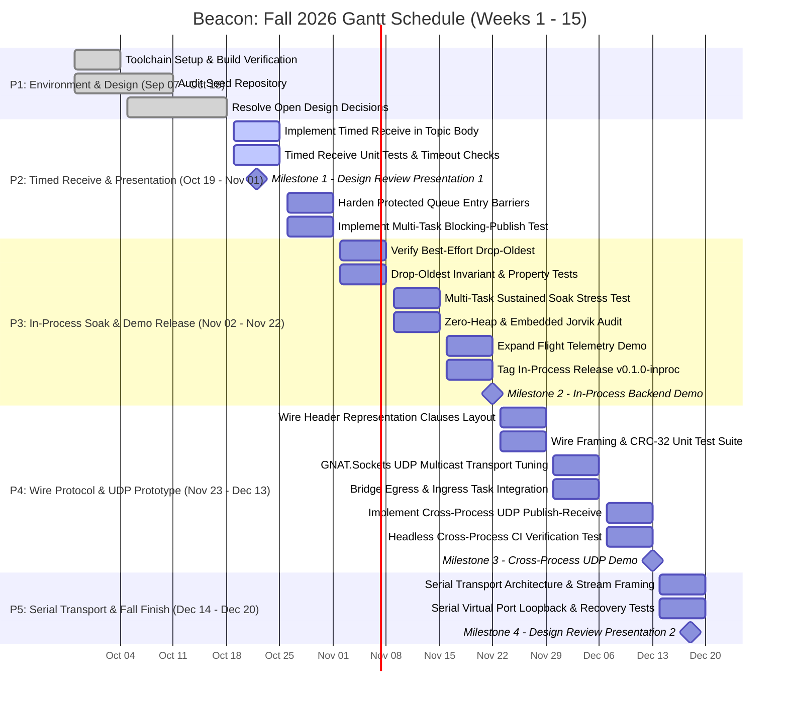

# Project Beacon: Gantt Schedule & Work Breakdown Matrix
## Fall 2026 15-Week Timeline & Phase Mapping (Weeks 1–15: Sep 07 – Dec 20, 2026)

**Project:** Beacon: Typed Publish-Subscribe Messaging Library in Ada
**Course:** STG-455: Capstone Project I — Grand Canyon University
**Sponsor:** AdaCore (GNAT Academic Program - GAP) & GCU
**Engineering Team:** Hovan Hodges (Core Systems Engineer), Ryan Tomasko (Security & Validation Engineer), Praise Jibunor (Network Systems Engineer)
**Repository:** [`GCU-beacon`](..)

---

## 15-Week Gantt Schedule Grid

*The following grid translates the official project spreadsheet schedule matrix across all 15 weeks of the Fall 2026 semester.*

| Phase | Tasks / Deliverables | W1 | W2 | W3 | W4 | W5 | W6 | W7 | W8 | W9 | W10 | W11 | W12 | W13 | W14 | W15 |
| :--- | :--- | :---: | :---: | :---: | :---: | :---: | :---: | :---: | :---: | :---: | :---: | :---: | :---: | :---: | :---: | :---: |
| **P1: Environment Setup & Design Decisions** *(Dark Red)* | Toolchain Setup & Build Verification | | | | █ | | | | | | | | | | | |
| | Audit Seed Repository | | | | █ | █ | | | | | | | | | | |
| | Resolve Open Design Decisions | | | | | █ | █ | | | | | | | | | |
| **P2: Timed Receive & Presentation** *(Red)* | Implement Timed Receive in Topic Body | | | | | | | █ | | | | | | | | |
| | Timed Receive Unit Tests & Timeout Checks | | | | | | | █ | | | | | | | | |
| | **Milestone 1 - Design Review Presentation 1** | | | | | | | ★ | | | | | | | | |
| | Harden Protected Queue Entry Barriers | | | | | | | | █ | | | | | | | |
| | Implement Multi-Task Blocking-Publish Test | | | | | | | | █ | | | | | | | |
| **P3: In-Process Soak & Demo Release** *(Orange)* | Verify Best-Effort Drop-Oldest | | | | | | | | | █ | | | | | | |
| | Drop-Oldest Invariant & Property Tests | | | | | | | | | █ | | | | | | |
| | Multi-Task Sustained Soak Stress Test | | | | | | | | | | █ | | | | | |
| | Zero-Heap & Embedded Jorvik Audit | | | | | | | | | | █ | | | | | |
| | Expand Flight Telemetry Demo | | | | | | | | | | | █ | | | | |
| | Tag In-Process Release v0.1.0-inproc | | | | | | | | | | | █ | | | | |
| | **Milestone 2 - In-Process Backend Demo** | | | | | | | | | | | ★ | | | | |
| **P4: Wire Protocol & UDP Prototype** *(Yellow)* | Wire Header Representation Clauses Layout | | | | | | | | | | | | █ | | | |
| | Wire Framing & CRC-32 Unit Test Suite | | | | | | | | | | | | █ | | | |
| | GNAT.Sockets UDP Multicast Transport Tuning | | | | | | | | | | | | | █ | | |
| | Bridge Egress & Ingress Task Integration | | | | | | | | | | | | | █ | | |
| | Implement Cross-Process UDP Publish-Receive | | | | | | | | | | | | | | █ | |
| | Headless Cross-Process CI Verification Test | | | | | | | | | | | | | | █ | |
| | **Milestone 3 - Cross-Process UDP Demo** | | | | | | | | | | | | | | ★ | |
| **P5: Serial Transport & Fall Finish** *(Green)* | Serial Transport Architecture & Stream Framing | | | | | | | | | | | | | | | █ |
| | Serial Virtual Port Loopback & Recovery Tests | | | | | | | | | | | | | | | █ |
| | **Milestone 4 - Design Review Presentation 2** | | | | | | | | | | | | | | | ★ |

---

## Calendar Dates & Week Mapping

| Week | Date Range (2026) | Primary Engineering Focus | Milestones / Gates |
| :---: | :---: | :--- | :--- |
| **W1** | Sep 07 – Sep 13 | Project Initiation & Academic Semester Start | — |
| **W2** | Sep 14 – Sep 20 | Team Charter & Role Distribution | — |
| **W3** | Sep 21 – Sep 27 | Repository Provisioning & Pre-flight Setup | — |
| **W4** | Sep 28 – Oct 04 | Toolchain Setup & GNAT 2022 Verification | Task 1.1 Complete |
| **W5** | Oct 05 – Oct 11 | Seed Code Audit & Stakeholder Feedback Interviews | Task 1.2 Complete |
| **W6** | Oct 12 – Oct 18 | Architectural Decisions Trade Study & Requirements Finalization | Task 1.3 Complete |
| **W7** | Oct 19 – Oct 25 | Timed `Receive` Implementation & Unit Test Suite | **Milestone 1 (Design Review 1)** |
| **W8** | Oct 26 – Nov 01 | Protected Entry Barrier Hardening & Multi-Task Blocking Tests | Phase 2 Complete |
| **W9** | Nov 02 – Nov 08 | Ring Buffer Drop-Oldest Verification & Property Tests | Tasks 3.1 & 3.2 Complete |
| **W10** | Nov 09 – Nov 15 | Multi-Task Sustained Soak Stress Test & Jorvik Zero-Heap Audit | Tasks 3.3 & 3.4 Complete |
| **W11** | Nov 16 – Nov 22 | Flight Telemetry Demo & Release Tagging | **Milestone 2 (`v0.1.0-inproc`)** |
| **W12** | Nov 23 – Nov 29 | 14-Byte Wire Header Representation Clauses & CRC-32 Tests | Tasks 4.1 & 4.2 Complete |
| **W13** | Nov 30 – Dec 06 | GNAT.Sockets UDP Multicast Tuning & Bridge Tasks Integration | Tasks 4.3 & 4.4 Complete |
| **W14** | Dec 07 – Dec 13 | Cross-Process Dual-Terminal Publishing & Headless CI Testing | **Milestone 3 (UDP Demo)** |
| **W15** | Dec 14 – Dec 20 | Serial UART Transport (COBS) & Virtual Port Loopback Tests | **Milestone 4 (Design Review 2)** |

---

## Mermaid Visual Schedule

