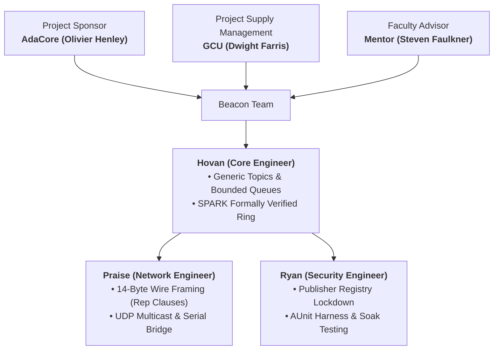

# Design Review Presentation 1: Slide Deck
## Capstone Design Concepts, Requirements Traceability, & Architectural Trade Study

**Course:** STG-455: Capstone Project I — Grand Canyon University  
**Sponsors:** AdaCore (GNAT Academic Program - GAP) & Grand Canyon University  
**Advisors & Sponsors:** Prof. Dwight Farris (GCU) | Steven Faulkner (GCU Mentor) | Olivier Henley (AdaCore GAP)  
**Engineering Team:** Hovan Hodges (Core) | Ryan Tomasko (Security & Validation) | Praise Jibunor (Network)  
**Repository:** [`GCU-beacon`](https://github.com/H000V/GCU-beacon)  

---

<!-- SLIDE 1 -->
## Slide 1: Title & Presentation Header

```
========================================================================================
                      STG-455 CAPSTONE PROJECT I
             GRAND CANYON UNIVERSITY & ADACORE GAP SPONSORSHIP

                                    BEACON
              Typed Publish-Subscribe Messaging Library in Ada
      Capstone Design Concepts, Requirements Traceability, & Architectural Trade Study
========================================================================================

Advisors & Sponsors:
  * Prof. Dwight Farris (GCU Course Instructor)
  * Steven Faulkner (GCU Capstone Mentor)
  * Olivier Henley (AdaCore GAP Coordinator & Industry Mentor)

Engineering Team:
  * Hovan Hodges (Core Systems Engineer)
  * Ryan Tomasko (Security & Validation Engineer)
  * Praise Jibunor (Network Systems Engineer)
========================================================================================
```

---

<!-- SLIDE 2 -->
## Slide 2: 01 / Project Context & Justification
### The Middleware Determinism Gap

```
+-----------------------------------------------------------------------------------------+
| Legacy C/C++ Middleware (ROS 2 / DDS)        | Project Beacon (Ada & SPARK Core)        |
+----------------------------------------------+------------------------------------------+
| • Untyped APIs: Raw void* buffers trigger   | • Type Is Topic: 100% compile-checked    |
|   silent corruption.                         |   generic instantiations.                |
| • Dynamic Heap: Runtime malloc causes        | • Zero Core Heap: Pre-allocated static   |
|   unbounded latency spikes.                  |   bounded ring buffers.                  |
| • Queue Overflows: High-rate producers       | • Explicit Modes: Static Reliable versus |
|   exhaust system memory.                     |   Best_Effort discriminants.             |
| • Complex Runtimes: Unprovable pointer       | • SPARK Silver: Mathematical proof of    |
|   arithmetic in flight code.                 |   ring index safety.                     |
+-----------------------------------------------------------------------------------------+
```

---

<!-- SLIDE 3 -->
## Slide 3: 02 / Engineering Organization
### Team Structure & Ownership



---

<!-- SLIDE 4 -->
## Slide 4: 01 / Who is AdaCore & Who Will Use Beacon?
### Industry Sponsorship & Target Users · Praise Jibunor

```
+-----------------------------------------------------------------------------------------+
| WHO IS ADACORE?                PHASE 1: EMBEDDED IOT & ROBOTICS  PHASE 2: AEROSPACE & DEFENSE|
+------------------------------+---------------------------------+------------------------+
| • 1994 NYU Origins: Founded   | • Target Builders: Drones and   | • Spaceflight Teams:   |
|   by original GNAT Ada        |   AMRs on Cortex-M, STM32,      |   CubeSat bus aligned  |
|   compiler architects.        |   RISC-V.                       |   with NASA cFE &      |
| • Verification Leader:        | • Zero-Heap Footprint:          |   CCSDS.               |
|   Commercial Ada compilers    |   Eliminates multi-megabyte     | • Certifiable Avionics:|
|   and SPARK proof engines.    |   RAM overhead of ROS 2.        |   Built for DO-178C    |
| • Mission Heritage: Airbus    | • No Fragmentation:             |   Level A/B airborne   |
|   A350, Boeing, NASA Artemis, |   Deterministic alternative     |   safety.              |
|   ESA, Alstom.                |   to dynamic C++ DDS.           | • Defense Standards:   |
| • GAP Sponsorship: Guided by  | • Alire Distribution: One-line  |   Conforms to The Open |
|   AdaCore Coordinator         |   install via:                  |   Group FACE TSS.      |
|   Olivier Henley.             |   'alr get adacore_beacon'.     | • Formal Proof: SPARK  |
|                               |                                 |   Silver guarantees    |
|                               |                                 |   zero runtime errors. |
+-----------------------------------------------------------------------------------------+
```

---

<!-- SLIDE 5 -->
## Slide 5: 03 / Mentor Consultations (Oct 14–15)
### Stakeholder Feedback Integration

* **01. Architectural Completeness (Olivier Henley, AdaCore)**  
  *Prioritize full aerospace rigor over casual shortcuts.* Ensure complete architectural design so grassroots embedded IoT adoption naturally scales to high-integrity aerospace systems.
* **02. Dual Subscriber Receive API (Steven Faulkner, GCU)**  
  *Add `Ada.Real_Time` Timed Receive alongside blocking entry.* Provide non-blocking / timeout capabilities to prevent task starvation while preserving deterministic blocking behavior.
* **03. Publisher Registry Lockdown (Steven Faulkner, GCU)**  
  *Lock registry post-elaboration against rogue tasks.* Enforce strict elaboration-time registration so third-party unauthorized tasks cannot inject rogue publishers at runtime.
* **04. Configurable Try_Publish Policy (Steven Faulkner, GCU)**  
  *Select `Partial_Delivery` or `All_Or_Nothing` equilibrium.* Provide explicit control over whether multi-subscriber fan-outs tolerate partial delivery or abort on full subscriber queues.

---

<!-- SLIDE 6 -->
## Slide 6: 04 / Verification & Traceability
### Functional Requirements Matrix

| Req ID | Requirement | Target Metric | Standard & Test Method |
| :---: | :--- | :--- | :--- |
| **FR-01** | **Frame Integrity Validation** | 100% corrupt detection | IEEE 802.3 CRC-32 bit-flip test |
| **FR-02** | **Public API Type Safety** | 0 untyped `void*` buffers | OMG DDS / Compiler check |
| **FR-03** | **Single Publisher Rule** | 1 publisher per topic | DDS Ownership / Unit test |
| **FR-04** | **Reliable Delivery Mode** | `Dropped = 0` invariant | DDS Reliability / Saturation test |
| **FR-05** | **Bounded FIFO Ring Queue** | 0 bytes heap in `src/` | Ada Jorvik / SPARK Silver proof |
| **FR-06** | **Timed Receive Operation** | Timeout $\ge 1\ \mu\text{s}$ | POSIX PSE51 / Delayed pub test |
| **FR-07** | **Publisher Registry Lockdown** | 0 post-init registrations | FACE TSS / Security injection test |
| **FR-08** | **Configurable Try_Publish** | 2 selectable policies | DDS Coherent Set / Mode test |

---

<!-- SLIDE 7 -->
## Slide 7: 05 / Selected Baseline Architecture
### Concept 1: Static Generic Queues — Compile-Time Decentralization

#### Compile-Time Topic Instantiation
```ada
package Temperature_Topic is new Beacon.Topic
  (Message_Type    => Telemetry.Reading,
   Queue_Depth     => 32,
   Max_Subscribers => 8);
```

#### Dual Protected Queue Barriers
* **Reliable:** Barrier `[Fill < Depth]` $\rightarrow$ `Dropped = 0` invariant guaranteed.
* **Best_Effort:** Barrier `[True]` $\rightarrow$ Overwrites oldest sample; increments drop count.

#### Architectural Pillars
* **Generic Instantiation:** Ada record type defines each topic package.
* **Direct Protected Fan-Out:** Producer dispatches without intermediate broker tasks.
* **Pure Ring Separation:** `Beacon.Queue` enables formal SPARK Silver mathematical proof.
* **Jorvik Concurrency:** Ceiling Priority Protocol prevents priority inversion.

---

<!-- SLIDE 8 -->
## Slide 8: 06 / Concept 1 Schematics & Assumptions
### Concept 1: Concurrency Topology

```
+=========================================================================================+
| [Sensor Task 1 kHz] === Direct Protected Entry Fan-Out (Registry LOCKED) ===>           |
|                                                                                         |
|       +------------------------------------+    +-------------------------------------+ |
|       | Left: Sub 1 RELIABLE               |    | Right: Sub 2 BEST_EFFORT            | |
|       | [Fill < Depth | Head=0 Tail=3 |    |    | [Always True | Overwrites Oldest]   | |
|       |  Dropped=0]                        |    |                                     | |
|       +------------------------------------+    +-------------------------------------+ |
+=========================================================================================+
```

#### Key Assumptions & Proof Model
* **Static Bounds & Lockdown:** Pre-flight elaboration locks subscriber registry against rogue writers.
* **Reliable Entry Barrier:** Closed barrier blocks producer upon queue saturation (`Dropped = 0`).
* **Relaxed Ring Proof:** GNATprove verifies valid `Head`-to-`Tail` reads using `Relaxed_Initialization`.

---

<!-- SLIDE 9 -->
## Slide 9: 07 / Industry Alternative Architecture
### Concept 2: Dynamic Heap Broker
#### 2x + N Task Context Switches Plus Per-Subscriber Heap `malloc` Calls | Centralized Dispatcher Daemon

* **Intermediary Broker Task:** Producer enqueues raw byte envelopes to a central background daemon task.
* **String Topic Lookup:** Runtime hash maps dynamically evaluate string topic names at runtime (e.g. `"/sensor/telemetry"`).
* **Heap Cloning:** Broker invokes runtime `malloc` to clone message envelopes for each matching subscriber.
* **Untyped Byte Streams:** Consumers cast raw `Stream_Element_Array` pointers into domain types via unchecked conversions.

---

<!-- SLIDE 10 -->
## Slide 10: 08 / Concept 2 Schematics & Hazards
### Concept 2: Pipeline & Jitter Risks

```
[Producer] ---> malloc(Bytes) ---> [Central Mailbox] ---> [Broker Task Hash("/telemetry")]
                                                                   |
                                          +------------------------+
                                          |
                                          v
                              malloc Clones ---> [Consumer free()]
```

#### Identified Hazards
* **C2-A1 Heap Dependency:** Requires runtime `malloc` allocator across shared memory pools.
* **C2-A2 Latency Jitter:** Memory compaction pauses violate hard 1 kHz real-time deadlines.
* **Memory Fragmentation:** Sustained 24-hour operations risk Out-Of-Memory (OOM) fatal crashes.
* **C2-A3 Open Topology:** Dynamic strings allow unauthorized rogue third-party message injection.
* **C2-A4 Byte Deserialization:** Unchecked type casts risk silent memory payload corruption in flight.
* **Pointer Hazards:** Manual consumer `free()` deallocation creates dangling pointers and double-free faults.

---

<!-- SLIDE 11 -->
## Slide 11: 09 / Quantitative Trade Study
### Pugh Concept Decision Matrix

| Evaluation Criteria | Weight | Concept 1 (Static) | Concept 2 (Broker) | Technical Justification |
| :--- | :---: | :---: | :---: | :--- |
| **Type Safety (FR-02)** | 15% | +2 (+0.30) | -2 (-0.30) | Compile-checked generics vs. raw byte casts |
| **Zero Heap Determinism (FR-05)** | 25% | +2 (+0.50) | -2 (-0.50) | 0 bytes core heap vs. `malloc` latency jitter |
| **Reliable Delivery (FR-04)** | 20% | +2 (+0.40) | -1 (-0.20) | Protected entry barrier vs. OOM packet drops |
| **SPARK Provability (FR-05)** | 15% | +2 (+0.30) | -2 (-0.30) | Silver ring proof vs. unprovable pointer arithmetic |
| **Publisher Security (FR-07)** | 15% | +2 (+0.30) | -2 (-0.30) | Post-init lockdown vs. open string topic injection |
| **Runtime Topology Flexibility** | 10% | -1 (-0.10) | +2 (+0.20) | Compile-time static vs. ad-hoc runtime discovery |
| **TOTAL WEIGHTED SCORE** | **100%** | **+1.70 (SELECTED)** | **-1.40 (REJECTED)** | **Concept 1 selected as formal baseline** |

---

<!-- SLIDE 12 -->
## Slide 12: 10 / Aerospace & Defense Compliance
### Application of Industry Standards

* **ISO/IEC 8652:2023 Jorvik:** Ceiling Priority Protocol guarantees bounded execution time and eliminates priority inversion.
* **IEEE 802.3-2022 CRC-32:** Polynomial `0xEDB88320` mathematically validates packed 14-byte wire headers.
* **UDP RFC 768 & Multicast RFC 1112:** Deterministic datagram sockets bridge isolated OS desktop processes.
* **Open Group FACE TSS 3.1:** Generic Ada interfaces decouple application components from underlying transport layers.
* **NASA cFE & CCSDS SOIS:** Strongly typed `Telemetry.Reading` replaces untyped C-based flight software buses.
* **OMG DDS v1.4 QoS:** Static discriminants enforce `RELIABLE` (blocking) or `KEEP_LAST` (overwrite oldest) policies.

---

<!-- SLIDE 13 -->
## Slide 13: 11 / Execution Schedule & Milestones
### Concept Development Next Steps

```
+-----------------------------------------------------------------------------------------+
| PHASE 2 · W07–W08 (OCT 2026)      Timed Receive & Gate 1                                |
|                                   Implement Ada.Real_Time timeout API for Design        |
|                                   Review 1 presentation.                                |
|-----------------------------------------------------------------------------------------|
| PHASE 3 · W09–W11 (NOV 2026)      Soak Stress & v0.1.0 Tag                              |
|                                   Verify Dropped = 0 invariant under multi-task soak    |
|                                   load.                                                 |
|-----------------------------------------------------------------------------------------|
| PHASE 4–5 · W12–W15 (DEC 2026)    UDP & Serial Bridges                                  |
|                                   Complete 14-byte CRC-32 framing alongside COBS UART   |
|                                   link.                                                 |
|-----------------------------------------------------------------------------------------|
| PHASE 6–9 · W16–W32 (SPRING 2027) SPARK Proof & Alire Index                             |
|                                   Discharge 100% Silver proofs for adacore_beacon       |
|                                   release.                                              |
+-----------------------------------------------------------------------------------------+
```

---

<!-- SLIDE 14 -->
## Slide 14: Fall 2026 Gantt Chart / Project Timeline

```
Phase / Task                       W1  W2  W3  W4  W5  W6  W7  W8  W9  W10 W11 W12 W13 W14 W15
-------------------------------------------------------------------------------------------------
P1: Environment Setup & Decisions
    Toolchain Setup & Build Verif              [==]
    Audit Seed Repository                      [======]
    Resolve Open Design Decisions                  [======]
P2: Timed Receive & Presentation
    Implement Timed Receive                                [==]
    Timed Receive Tests & Checks                           [==]
    Milestone 1 - Design Review 1                          [*]
    Harden Protected Queue Barriers                            [==]
    Multi-Task Blocking-Publish Test                           [==]
P3: In-Process Soak & Demo Release
    Verify Best-Effort Drop-Oldest                                 [==]
    Drop-Oldest Invariant Tests                                    [==]
    Multi-Task Sustained Soak Test                                     [==]
    Zero-Heap & Jorvik Audit                                           [==]
    Expand Flight Telemetry Demo                                           [==]
    Tag In-Process Release v0.1.0                                          [==]
    Milestone 2 - In-Process Demo                                          [*]
P4: Wire Protocol & UDP Prototype
    Wire Header Rep Clauses Layout                                             [==]
    Wire Framing & CRC-32 Test Suite                                           [==]
    UDP Multicast Transport Tuning                                                 [==]
    Bridge Egress & Ingress Tasks                                                  [==]
    Cross-Process UDP Pub-Receive                                                      [==]
    Headless Cross-Process CI Test                                                     [==]
    Milestone 3 - UDP Demo                                                             [*]
P5: Serial Transport & Fall Finish
    Serial Transport Architecture                                                          [==]
    Serial Virtual Port Loopback                                                           [==]
    Milestone 4 - Design Review 2                                                          [*]
```

---

<!-- SLIDE 15 -->
## Slide 15: 12 / Summary & Defense Interrogation
### Q&A

```
========================================================================================
                                     QUESTIONS?
                       Floor Open for Technical Interrogation
========================================================================================

Team Roster:
  * Hovan Hodges (Core Systems Engineer)
  * Ryan Tomasko (Security & Validation Engineer)
  * Praise Jibunor (Network Systems Engineer)

Open Source Repository:
  https://github.com/H000V/GCU-beacon
========================================================================================
```

---

<!-- SLIDE 16 -->
## Slide 16: 13 / Academic, Government & Industry Citations
### References (APA 7th Edition)

* **AdaCore.** (2022). *SPARK 2022 reference manual: Formally proving safety and security*. AdaCore Documentation. https://docs.adacore.com/spark2022-docs/html/ug/
* **ISO/IEC 8652:2023.** (2023). *Information technology — Programming languages — Ada: Annex D.13 The Jorvik profile*. ISO. https://www.iso.org/standard/83621.html
* **IEEE Std 802.3-2022.** (2022). *IEEE standard for Ethernet: Clause 3.2.9 Frame check sequence (FCS) field*. IEEE. https://doi.org/10.1109/IEEESTD.2022.9844436
* **NASA.** (2020). *Core Flight Executive (cFE) application programmer’s interface (Version 6.7)*. Goddard Space Flight Center. https://github.com/nasa/cFE
* **CCSDS 851.0-M-1.** (2014). *Spacecraft onboard interface services — Subnetwork packet service*. Consultative Committee for Space Data Systems. https://public.ccsds.org/Pubs/851x0m1.pdf
* **OMG DDS v1.4.** (2015). *Data Distribution Service (DDS) specification: Clause 2.2.3 Quality of Service (QoS) policies*. Object Management Group. https://www.omg.org/spec/DDS/1.4/
* **The Open Group.** (2020). *Future Airborne Capability Environment (FACE™) technical standard, edition 3.1*. The Open Group. https://www.opengroup.org/face
* **RTCA DO-178C & DO-333.** (2011). *Software considerations in airborne systems and equipment certification & Formal methods supplement*. RTCA, Inc.
* **Postel, J.** (1980). *User Datagram Protocol* (IETF RFC 768 & RFC 1112). Internet Engineering Task Force. https://doi.org/10.17487/RFC0768
* **Taft, S. T., Duff, R. A., Brukardt, R. L., Pinho, L. M., & Henley, O.** (2023). *Ada 2022 reference manual: Language and standard libraries*. Springer Nature. https://doi.org/10.1007/978-3-031-29704-5
