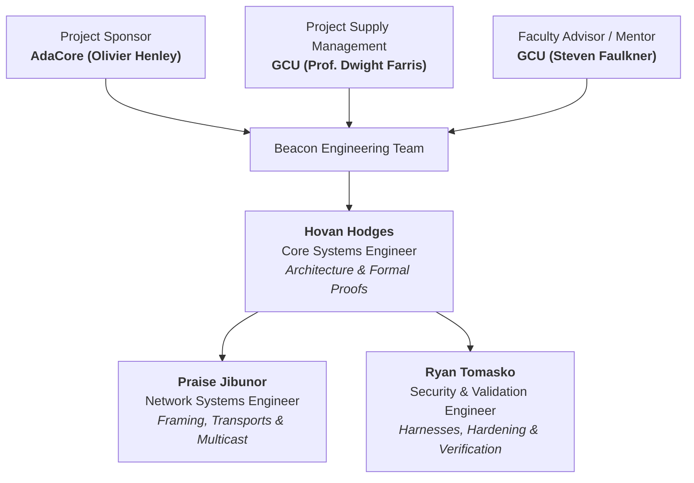

# AdaCore & Grand Canyon University
# BEACON: Typed Publish-Subscribe Messaging Library in Ada
## Project Charter

**Version:** 1.0  
**Date:** October 4, 2026  
**Course:** STG-455: Capstone Project I  
**Institution:** Grand Canyon University (GCU)  
**Instructor:** Professor Dwight Farris  
**Team Mentor:** Steven Faulkner (GCU)  
**Industry Partner & Sponsor:** AdaCore (GNAT Academic Program - GAP Coordinator: Olivier Henley)  

---

## Revision History

| Date | Version | Description | Author |
| :--- | :--- | :--- | :--- |
| 10/04/2026 | 1.00 | Initial Project Charter Creation | H. Hodges, R. Tomasko, P. Jibunor |
| 10/28/2026 | 1.10 | Team Consolidation (Ryan Tomasko assumes all Validation Engineer duties) | H. Hodges, R. Tomasko, P. Jibunor |

---

## Table of Contents

1. [Project / Purpose Justification](#project--purpose-justification)
2. [Objectives and Success Criteria](#objectives-and-success-criteria)
3. [Requirements](#requirements)
4. [Project Assumptions and / or Constraints](#project-assumptions-and--or-constraints)
   * [Constraints](#constraints)
   * [Assumptions](#assumptions)
5. [Preliminary Risk Statement](#preliminary-risk-statement)
6. [Summary Milestone Schedule](#summary-milestone-schedule)
7. [Summary Estimated Budget](#summary-estimated-budget)
8. [Project Organization](#project-organization)
   * [Project Organization Chart](#project-organization-chart)
   * [Roles and Responsibilities](#roles-and-responsibilities)
9. [Appendices](#appendices)
   * [Appendix A: Functional Requirements Matrix](#appendix-a-functional-requirements-matrix)
   * [Appendix B: References](#appendix-b-references)
   * [Appendix C: Industry Standards Alignment](#appendix-c-industry-standards-alignment)

---

## Project / Purpose Justification

The purpose of the **Beacon** project is to develop a typed publish-subscribe messaging library in Ada for both in-process and cross-process desktop communication. 

By relying on Ada generics instead of the untyped byte buffers common in C or C++ systems (such as ROS 2 and traditional DDS implementations), Beacon eliminates silent runtime type-casting errors and ensures that publishers and subscribers agree on message types at compile time. 

The system requirements mandate the creation of task-safe, bounded queues with explicit **Reliable** (blocking) and **Best_Effort** (dropping oldest) delivery modes, alongside a UDP multicast network backend using representation clauses for deterministic message framing without dynamic heap allocation.

---

## Objectives and Success Criteria

The primary goal of the Beacon project is to deliver a functional, type-safe publish-subscribe messaging library in Ada that eliminates silent runtime type-casting errors common in traditional C/C++ systems. 

By leveraging Ada generics and bounded protected queues, the project provides explicit reliable and best-effort delivery modes without relying on dynamic heap allocation. Strategically, this outcome expands AdaCore’s ecosystem by supplying load-bearing middleware critical for high-reliability industries like aerospace and robotics. 

Project success will be measured by:
- Absolute type safety with zero untyped byte buffers in the public API.
- A 100% success rate in preventing silent message drops under sustained load for reliable queues.
- Achieving a Silver-level SPARK proof for memory safety on the ring buffer implementation.
- Successfully publishing the `adacore_beacon` library as an Alire crate.

### Strategic Alignment Matrix

| Business Strategy Objective | Project Objective |
| :--- | :--- |
| **Expand the Ada software ecosystem** into high-reliability markets (such as robotics and aerospace) by providing robust, load-bearing middleware infrastructure. | Successfully publish the `adacore_beacon` library to the community index as an Alire crate, measured by a clean installation and build process using standard `alr` commands. |
| **Improve software reliability and technical efficiency** by eliminating runtime type-casting overhead and the risk of silent errors. | Achieve absolute compile-time type safety by utilizing Ada generics, guaranteeing zero untyped byte buffers or `void*` casts within the public API. |
| **Reduce long-term debugging costs and mitigate runtime memory failures** through formal software verification. | Achieve a Silver-level SPARK proof using GNATprove on the `Beacon.Queue` package to mathematically guarantee that ring buffer index arithmetic never exceeds array bounds and fill counts remain accurate. |
| **Ensure strict operational process improvements** through verifiable, bounded data delivery guarantees without relying on dynamic heap allocation. | Implement task-safe bounded protected queues that demonstrate a 100% success rate in preventing silent message drops under sustained load when configured in reliable mode. |

---

## Requirements

1. **Send typed messages:** Each topic carries one specific kind of message, and the compiler rejects anything else.
2. **Use fixed-size queues:** Each subscriber has an inbox that never grows dynamically at runtime.
3. **Support two delivery modes:**
   - **Reliable:** Guarantees zero message loss by blocking the publisher on queue saturation.
   - **Best-Effort:** Drops the oldest message when the inbox is full, incrementing an atomic drop counter.
4. **Operate across environments:** Work seamlessly inside one program (in-process) and between separate programs over a network (cross-process).
5. **Formally proven safe and secure:** Core queue buffer index operations and invariants are formally verified with SPARK.
6. **Include tests and demonstrations:** Provide automated test suites and a demonstration application exhibiting both delivery modes under concurrent load.
7. **Package for distribution:** Publish as an open-source Alire package installable by any developer, accompanied by comprehensive architectural documentation.

---

## Project Assumptions and / or Constraints

The Beacon capstone project operates under several strict technical, operational, and architectural constraints, alongside specific environmental assumptions.

### Constraints

* **Compile-Time Type Safety:** The library must use Ada generics exclusively for message type definition; untyped byte buffers, `void*` casts, and `System.Address` payloads are prohibited in the public API.
* **Bounded Memory Allocation:** All subscriber queues must be statically bounded at instantiation with no dynamic growth, ensuring zero heap allocation occurs within the core [`src/`](../src) directory.
* **Network Independence in Core:** The in-process backend ([`src/beacon-topic.ads`](../src/beacon-topic.ads) and [`src/beacon-queue.ads`](../src/beacon-queue.ads) must compile and run completely free of any network dependencies or socket libraries.
* **Wire Framing Discipline:** Message framing for the network transport must be implemented using Ada representation clauses overlaid on records, strictly avoiding manual byte-packing via bit-shifts and masks.

### Assumptions

* **Operating Environment:** The cross-process network backend will operate on a standard desktop operating system connected to a local area network (LAN) supporting UDP multicast routing (RFC 1112).
* **Embedded Target Capability:** If the stretch goal of an embedded target is pursued, it is assumed that it will only support the in-process backend; furthermore, a Zero Footprint Profile (ZFP) runtime will require bypassing the protected `Beacon.Topic` package and using the pure `Beacon.Queue` directly.
* **Proof Tooling Compatibility:** The GNATprove tooling will successfully utilize the `Relaxed_Initialization` aspect to verify the array buffer, as `Element_Type` may not have default initialization.

---

## Preliminary Risk Statement

| Risk Identified | Root Cause / Context | Mitigation Strategy |
| :--- | :--- | :--- |
| **Exploits / Backdoors from Coding Inexperience** | Potential vulnerabilities or logic flaws resulting from team members' initial learning curve with Ada tasking and memory semantics. | Implement rigorous automated AUnit testing, peer code reviews, mentor signoffs, and a thorough final code-hardening and polishing audit. |
| **In-Transit Message Injection & Tampering** | Malicious tasks injecting or altering payloads over the network transport. | Implement IEEE 802.3 CRC-32 frame validation on wire headers and evaluate transport-level payload encryption. |
| **Generic Instantiation & Type Constraints** | Complex generic parameterization potentially limiting supported message types or causing compilation/elaboration issues. | Frequently test generic instantiations across primitive, record, and composite types in continuous integration builds. |

---

## Summary Milestone Schedule

| Timeline | Milestone Goals & Deliverables |
| :--- | :--- |
| **Weeks 1–4: Architecture & Generic Design** | • Design the `Beacon.Topic` generic package: publisher, subscriber, delivery modes. • Specify the protected queue type and overflow behavior for both delivery modes. • Mentor architecture review at Week 4: generic interface signoff. |
| **Weeks 5–8: In-Process Backend** | • Implement bounded protected queue with Jorvik Ceiling Priority Protocol. • Verify Reliable and Best-Effort delivery modes operating concurrently. • Execute single-process test: multiple publishers and subscribers on different topic instantiations. |
| **Weeks 9–12: Demonstration & Checkpoint** | • Develop simulated telemetry application: 2–3 topics at varying rates with mixed modes. • Load testing: verify reliable mode never drops data, best-effort drops oldest under overflow. • Tag and release `v0.1.0-inproc` backend checkpoint. |
| **Weeks 13–16: Network Backend Design & Prototype** | • Design UDP multicast transport with 14-byte representation-claused wire framing. • Establish first cross-process publish and receive between separate processes on the same host. |
| **Weeks 17–22: Network Backend Completion** | • Full UDP multicast backend supporting multiple publishers and subscribers across processes. • Static participant and topic configuration. • Extend demonstration application to operate across physical/virtual network bridges. |
| **Weeks 23–26: SPARK Verification & Robustness** | • Run GNATprove on `Beacon.Queue` targeting formal SPARK Silver proof. • Execute sustained multi-task stress and soak testing under peak load. • Benchmark latency and jitter comparing in-process vs. network backends. |
| **Weeks 27–29: Documentation & Alire Packaging** | • Comprehensive API reference and delivery guarantee specification. • Comparative whitepaper: architectural trade study between Beacon and full OMG DDS. • Package manifest preparation for Alire community index (`adacore_beacon`). |
| **Weeks 30–32: Final Demonstration & Delivery** | • Live demonstration: multi-process simulated sensor network under mixed delivery modes. • Capstone final defense report defending delivery guarantees and generic design. • Submission of `adacore_beacon` crate to Alire community index. |

---

## Summary Estimated Budget

The forecasted budget for the Beacon project is **\$1,400.00**, funded through Grand Canyon University (GCU). This forecasted amount will be adjusted during the Concept Development, Planning, and Requirements Analysis Phases to derive a more precise budget.

| Rough Order of Magnitude (ROM) Item | ROM Estimate | Notes / Vendor |
| :--- | :--- | :--- |
| Developer Toolchains (Alire, GNAT compiler, VS Code, GitHub, Discord) | \$0.00 | Free / Open-Source Academic Licenses |
| Claude & AI Pair-Programming Subscriptions | \$200.00 / month | Project Research & Accelerated Development |
| **Total Forecasted Project Budget** | **\$1,400.00** | Allocated via GCU Capstone Sponsorship |

---

## Project Organization

### Project Organization Chart

### Roles and Responsibilities

* **Core Systems Engineer (Hovan Hodges):**  
  Responsible for core library architecture, generic package design ([`src/beacon.ads`](../src/beacon.ads), [`src/beacon-topic.ads`](../src/beacon-topic.ads), [`src/beacon-queue.ads`](../src/beacon-queue.ads), protected object synchronization primitives, and SPARK Silver proof contracts.
* **Network Systems Engineer (Praise Jibunor):**  
  Responsible for network transport architecture ([`src/net/beacon-wire.ads`](../src/net/beacon-wire.ads), [`src/net/beacon-transport-udp.adb`](../src/net/beacon-transport-udp.adb), [`src/net/beacon-bridge.ads`](../src/net/beacon-bridge.ads), IEEE 802.3 CRC-32 integrity validation, representation clause framing, and serial stream bridges.
* **Security & Validation Engineer (Ryan Tomasko):**  
  Responsible for end-to-end software verification, validation, and security hardening: authoring automated AUnit unit and property test suites ([`tests/src/topic_tests.adb`](../tests/src/topic_tests.adb), [`tests/src/wire_tests.adb`](../tests/src/wire_tests.adb), executing multi-task concurrency soak stress tests, enforcing post-initialization publisher registry lockdown, managing embedded zero-heap memory profiling (`gnatmem`), validating queue barrier invariants, and maintaining headless cross-platform CI/CD verification workflows ([`.github/workflows/ci.yml`](../.github/workflows/ci.yml).

---

## Appendices

### Appendix A: Functional Requirements Matrix

**Authors:** Hovan Hodges, Ryan Tomasko, Praise Jibunor  
**Course:** STG-455: Capstone Project I — Grand Canyon University  
**Instructor:** Professor Dwight Farris  
**Date:** October 18, 2026  

| Functional Requirement | Relationship to Customer Feedback | Relationship to Industry Standard(s) | How Will the Functional Requirement Be Measured? |
| :--- | :--- | :--- | :--- |
| **Frame Integrity Validation (CRC-32)** | Required for data corruption validation on untrusted physical links | IEEE 802.3 Cyclic Redundancy Check (Clause 3.2.9) | False bit-flipping error injection unit test suite |
| **Type Safety at Public API** | Zero untyped raw memory buffers sent to application subscribers | OMG DDS v1.4 (§7.1.3 DCPS model) | Compiler rejection when attempting to pass untyped memory buffers |
| **Single Publisher Enforcement** | Ensure single-writer ownership per topic instantiation to avoid race conditions | OMG DDS QoS Ownership Policy | Unit test asserting compile or runtime failure on multiple publisher creation |
| **Blocking on Full Reliable Queue** | Ensure zero data loss (`Dropped = 0`) to critical reliable subscribers | OMG DDS QoS Reliability Policy | Verifying that `Dropped = 0` invariant holds when saturated queue blocks publisher |
| **Bounded FIFO Ring Buffer for Queues** | Ensure deterministic sequential delivery without unbounded memory growth | ISO/IEC 8652 Jorvik Profile & SPARK | GNATprove SPARK Silver formal mathematical proof of buffer index boundaries |

---

### Appendix B: References

* Consultative Committee for Space Data Systems. (2014). *Spacecraft onboard interface services — Subnetwork packet service* (CCSDS Standard No. 851.0-M-1). CCSDS. https://public.ccsds.org/Pubs/851x0m1.pdf
* Institute of Electrical and Electronics Engineers. (2022). *IEEE standard for Ethernet: Clause 3.2.9 Frame check sequence (FCS) field* (IEEE Std 802.3-2022). IEEE. https://doi.org/10.1109/IEEESTD.2022.9844436
* International Organization for Standardization, & International Electrotechnical Commission. (2023). *Information technology — Programming languages — Ada: Annex D.13 The Jorvik profile* (ISO/IEC Standard No. 8652:2023). ISO. https://www.iso.org/standard/83621.html
* National Aeronautics and Space Administration. (2020). *Core Flight Executive (cFE) application programmer’s interface* (Version 6.7). Goddard Space Flight Center. https://github.com/nasa/cFE
* Object Management Group. (2015a). *Data Distribution Service (DDS) specification* (Version 1.4, OMG Document No. formal/2015-04-10). OMG. https://www.omg.org/spec/DDS/1.4/
* Object Management Group. (2015b). *Data Distribution Service (DDS) specification: Clause 2.2.3 Quality of Service (QoS) policies* (Version 1.4, OMG Document No. formal/2015-04-10). OMG. https://www.omg.org/spec/DDS/1.4/
* Postel, J. (1980). *User Datagram Protocol* (RFC No. 768). Internet Engineering Task Force. https://doi.org/10.17487/RFC0768
* The Open Group. (2020). *Future Airborne Capability Environment (FACE™) technical standard, edition 3.1*. The Open Group. https://www.opengroup.org/face

---

### Appendix C: Industry Standards Alignment

| Industry Standard | Standard Description | How the Industry Standard Applies to Beacon |
| :--- | :--- | :--- |
| **ISO/IEC 8652 (Jorvik Profile)** | Ada programming language standard governing deterministic real-time embedded systems. | Beacon uses Ada 2022 as its core language; protected objects utilize the Jorvik profile with Ceiling Priority Protocol to prevent unbounded priority inversion. |
| **IEEE 802.3 Cyclic Redundancy Check** | CRC-32 polynomial (`0xEDB88320`) used for network transmission integrity verification. | Beacon calculates and verifies CRC-32 checksums over the packed 14-byte wire frame headers before delivering payloads to subscribers. |
| **UDP (RFC 768)** | Connectionless transport protocol standard for low-latency datagram delivery. | Beacon's network transport backend uses UDP datagrams to transport framed messages between isolated OS desktop processes. |
| **IP Multicast (RFC 1112)** | Standard for one-to-many datagram transmission across local network segments. | Beacon utilizes IP multicast so that a single publisher dispatch efficiently reaches multiple distributed subscribers simultaneously. |
| **The Open Group FACE (Transport Services Segment)** | US DoD standard decoupling typed business logic components from underlying transports (UDP, shared memory, bus). | Beacon mirrors the FACE TSS architecture by using compile-time typed generic topics, enforcing deterministic bounded queues with explicit delivery modes, and isolating network I/O in transparent bridge tasks. |
| **Spaceflight (CCSDS SOIS & NASA cFE Software Bus)** | Flight software standards defining deterministic pub-sub onboard buses for routing spacecraft telemetry. | Beacon improves upon traditional C-based flight buses by replacing untyped byte buffers with compile-time generic Ada types (`Telemetry.Reading`), while preserving spaceflight-grade bounded protected queues, drop-oldest semantics, and UDP desktop simulation bridges. |
