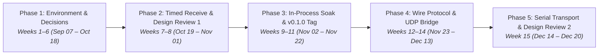

# Project Beacon: Work Breakdown Structure (WBS) & Fall 2026 Schedule
## Comprehensive Task Catalog, Ownership & Dependency Tree (Weeks 1–15: Sep 07 – Dec 20, 2026)

**Project:** Beacon: Typed Publish-Subscribe Messaging Library in Ada  
**Course:** STG-455: Capstone Project I — Grand Canyon University  
**Sponsor:** AdaCore (GNAT Academic Program - GAP)  
**Engineering Team:**  
* **Hovan Hodges:** Core Systems Engineer *(Architecture, Generics & Formal Proofs)*  
* **Ryan Tomasko:** Security & Validation Engineer *(Security Hardening, Unit/Soak Testing, Invariants & Verification)*  
* **Praise Jibunor:** Network Systems Engineer *(Wire Framing, Transports, Multicast & Bridges)*  
**Repository:** [`GCU-beacon`](..)  

---

## Executive Summary of Phases

---

## Detailed Task Breakdown & Ownership

### Phase 1: Environment Setup & Design Decisions (Weeks 1–6: Sep 07 – Oct 18, 2026)

* **Task 1.1: Toolchain Setup & Build Verification**
  * **Lead Engineer:** Hovan Hodges (Core Systems Engineer) with Full Team
  * **Description:** Install and configure the native Ada development environment, verifying builds using the Alire package manager and GNAT 2022 compiler toolchain.
  * **Resources Required:** Alire 2.1+ package manager; native GNAT 2022 compiler toolchain (`gnat_native 14+`); GitHub repository ([`GCU-beacon`](..).
  * **Time Needed:** 6 hours (2 hrs/member across 3 team members) | **Duration:** 1 week (Sep 28 – Oct 04, 2026).
  * **Costs Associated:** \$0.
  * **Predecessors & Successors:**
    * *Predecessors:* None (Project Initiation).
    * *Successors:* Task 1.2, Task 1.3.

* **Task 1.2: Audit Seed Repository**
  * **Lead Engineer:** Hovan Hodges (Core Systems Engineer)
  * **Description:** Perform initial code review and baseline audit of the provided Ada seed codebase to verify generic packaging, zero-heap constraints, and baseline test suite.
  * **Resources Required:** Native GNAT 2022 compiler toolchain (`gnat_native 14+`); GitHub repository ([`GCU-beacon`](..); Visual Studio Code.
  * **Time Needed:** 20 hours | **Duration:** 2 weeks (Sep 28 – Oct 11, 2026).
  * **Costs Associated:** \$0.
  * **Predecessors & Successors:**
    * *Predecessors:* Task 1.1.
    * *Successors:* Task 1.3.

* **Task 1.3: Resolve Open Design Decisions**
  * **Lead Engineer:** Full Engineering Team (Hovan Hodges, Ryan Tomasko, Praise Jibunor)
  * **Description:** Conduct stakeholder trade study consultations with Olivier Henley (AdaCore) and Steven Faulkner (GCU) to resolve open architectural decisions (e.g. timed receive, publisher registry lockdown, configurable `Try_Publish` policy).
  * **Resources Required:** Ada 2022 Reference Manual; OMG DDS v1.4 Specification; [`ARCHITECTURE.md`](../ARCHITECTURE.md).
  * **Time Needed:** 12 hours (4 hrs/member across 3 team members) | **Duration:** 2 weeks (Oct 05 – Oct 18, 2026).
  * **Costs Associated:** \$0.
  * **Predecessors & Successors:**
    * *Predecessors:* Task 1.1, Task 1.2.
    * *Successors:* Task 2.1, Task 2.2.

---

### Phase 2: Timed Receive & Design Review Presentation (Weeks 7–8: Oct 19 – Nov 01, 2026)

* **Task 2.1: Implement Timed Receive in Topic Body**
  * **Lead Engineer:** Hovan Hodges (Core Systems Engineer)
  * **Description:** Implement non-infinite `Receive` procedure with timeout using `Ada.Real_Time.Time_Span`, preventing subscriber task starvation.
  * **Resources Required:** GNAT 2022 compiler; Ada tasking runtime; [`src/beacon-topic.ads`](../src/beacon-topic.ads) and [`src/beacon-topic.adb`](../src/beacon-topic.adb); Visual Studio Code.
  * **Time Needed:** 12 hours | **Duration:** 1 week (Oct 19 – Oct 25, 2026).
  * **Costs Associated:** \$0.
  * **Predecessors & Successors:**
    * *Predecessors:* Task 1.3.
    * *Successors:* Task 2.2, Milestone 1.

* **Task 2.2: Timed Receive Unit Tests & Timeout Checks**
  * **Lead Engineer:** Ryan Tomasko (Security & Validation Engineer)
  * **Description:** Create dedicated automated unit test cases in AUnit validating timeout expiration, successful item retrieval, and timeout unblocking behavior.
  * **Resources Required:** Unit test framework; [`tests/src/topic_tests.adb`](../tests/src/topic_tests.adb); Visual Studio Code.
  * **Time Needed:** 12 hours | **Duration:** 1 week (Oct 19 – Oct 25, 2026).
  * **Costs Associated:** \$0.
  * **Predecessors & Successors:**
    * *Predecessors:* Task 1.3, Task 2.1.
    * *Successors:* Task 2.3, Milestone 1.

* **Milestone 1: Design Review Presentation 1**
  * **Lead Engineer:** Full Engineering Team
  * **Description:** Deliver formal 15-minute Design Review Presentation covering design concepts, requirements traceability, and Pugh architectural trade study to faculty and mentors.
  * **Resources Required:** Microsoft PowerPoint; Presentation Slides ([`docs/PRESENTATION_SLIDES.md`](PRESENTATION_SLIDES.md).
  * **Time Needed:** 8 hours | **Duration:** 4 days (Oct 19 – Oct 22, 2026).
  * **Costs Associated:** \$0.
  * **Predecessors & Successors:**
    * *Predecessors:* Task 2.1, Task 2.2.
    * *Successors:* Task 2.3.

* **Task 2.3: Harden Protected Queue Entry Barriers**
  * **Lead Engineer:** Hovan Hodges (Core Systems Engineer) & Ryan Tomasko (Security & Validation Engineer)
  * **Description:** Audit and harden Ada Protected Object entry barriers with Ceiling Priority Protocol, verifying thread synchronization and boundary safety under high task concurrency.
  * **Resources Required:** GNAT tasking runtime with Ceiling Priority Protocol; GDB debugger; [`src/beacon-topic.adb`](../src/beacon-topic.adb); Visual Studio Code.
  * **Time Needed:** 10 hours | **Duration:** 1 week (Oct 26 – Nov 01, 2026).
  * **Costs Associated:** \$0.
  * **Predecessors & Successors:**
    * *Predecessors:* Task 2.1, Milestone 1.
    * *Successors:* Task 2.4, Task 3.1.

* **Task 2.4: Implement Multi-Task Blocking-Publish Test**
  * **Lead Engineer:** Ryan Tomasko (Security & Validation Engineer)
  * **Description:** Implement multi-threaded test runner verifying that publisher tasks block on saturated reliable subscriber queues and properly resume upon consumer drain without memory loss.
  * **Resources Required:** Multi-threaded test runner; [`tests/src/topic_tests.adb`](../tests/src/topic_tests.adb); atomic synchronization primitives; Visual Studio Code.
  * **Time Needed:** 16 hours | **Duration:** 1 week (Oct 26 – Nov 01, 2026).
  * **Costs Associated:** \$0.
  * **Predecessors & Successors:**
    * *Predecessors:* Task 2.3.
    * *Successors:* Task 3.1.

---

### Phase 3: In-Process Soak & Demo Release (Weeks 9–11: Nov 02 – Nov 22, 2026)

* **Task 3.1: Verify Best-Effort Drop-Oldest**
  * **Lead Engineer:** Hovan Hodges (Core Systems Engineer) & Ryan Tomasko (Security & Validation Engineer)
  * **Description:** Verify ring buffer overwrite-oldest pointer arithmetic in [`src/beacon-queue.adb`](../src/beacon-queue.adb) to guarantee accurate drop counting and zero corruption.
  * **Resources Required:** GNAT tracing utilities; [`src/beacon-queue.adb`](../src/beacon-queue.adb); Visual Studio Code.
  * **Time Needed:** 12 hours | **Duration:** 1 week (Nov 02 – Nov 08, 2026).
  * **Costs Associated:** \$0.
  * **Predecessors & Successors:**
    * *Predecessors:* Task 2.3, Task 2.4.
    * *Successors:* Task 3.2.

* **Task 3.2: Drop-Oldest Invariant & Property Tests**
  * **Lead Engineer:** Ryan Tomasko (Security & Validation Engineer)
  * **Description:** Build property-based randomized test generators to stress test ring buffer wrap-around, head/tail consistency, and FIFO sequence preservation.
  * **Resources Required:** Property-based randomized test generator; multi-core test host; [`tests/src/`](../tests/src); Visual Studio Code.
  * **Time Needed:** 16 hours | **Duration:** 1 week (Nov 02 – Nov 08, 2026).
  * **Costs Associated:** \$0.
  * **Predecessors & Successors:**
    * *Predecessors:* Task 3.1.
    * *Successors:* Task 3.3.

* **Task 3.3: Multi-Task Sustained Soak Stress Test**
  * **Lead Engineer:** Ryan Tomasko (Security & Validation Engineer)
  * **Description:** Subject the in-process core to sustained high-frequency load (e.g. 1 kHz publish rate) to verify memory stability, zero latency spikes, and the invariant `Dropped(Reliable) = 0`.
  * **Resources Required:** High-load multi-threaded test environment; CPU utilization monitor; [`tests/src/topic_tests.adb`](../tests/src/topic_tests.adb); Visual Studio Code.
  * **Time Needed:** 20 hours | **Duration:** 1 week (Nov 09 – Nov 15, 2026).
  * **Costs Associated:** \$0.
  * **Predecessors & Successors:**
    * *Predecessors:* Task 3.2.
    * *Successors:* Task 3.4, Task 3.5.

* **Task 3.4: Zero-Heap & Embedded Jorvik Audit**
  * **Lead Engineer:** Hovan Hodges (Core Systems Engineer) & Ryan Tomasko (Security & Validation Engineer)
  * **Description:** Profile core memory footprint using `gnatmem` and verify zero dynamic allocation in `src/` to ensure full compliance with the Ada Jorvik profile.
  * **Resources Required:** GNAT Jorvik embedded runtime; `gnatmem` heap profiling utility; `-fstack-check` compiler diagnostics; [`beacon.gpr`](../beacon.gpr); Visual Studio Code.
  * **Time Needed:** 16 hours | **Duration:** 1 week (Nov 09 – Nov 15, 2026).
  * **Costs Associated:** \$0.
  * **Predecessors & Successors:**
    * *Predecessors:* Task 3.3.
    * *Successors:* Task 3.5.

* **Task 3.5: Expand Flight Telemetry Demo**
  * **Lead Engineer:** Praise Jibunor (Network Systems Engineer) & Hovan Hodges (Core Systems Engineer)
  * **Description:** Enhance the in-process demonstration app with multi-rate telemetry topics simulating satellite flight instruments and control loops.
  * **Resources Required:** Flight simulation models; [`demo/src/inproc_demo.adb`](../demo/src/inproc_demo.adb) and [`demo/src/telemetry.ads`](../demo/src/telemetry.ads); Visual Studio Code.
  * **Time Needed:** 20 hours | **Duration:** 1 week (Nov 16 – Nov 22, 2026).
  * **Costs Associated:** \$0.
  * **Predecessors & Successors:**
    * *Predecessors:* Task 3.3, Task 3.4.
    * *Successors:* Task 3.6, Milestone 2.

* **Task 3.6: Tag In-Process Release v0.1.0-inproc**
  * **Lead Engineer:** Full Engineering Team (Lead: Hovan Hodges)
  * **Description:** Package and tag the verified in-process core release in Git, establishing the milestone baseline for subsequent network transports.
  * **Resources Required:** Git version control.
  * **Time Needed:** 14 hours | **Duration:** 1 week (Nov 16 – Nov 22, 2026).
  * **Costs Associated:** \$0.
  * **Predecessors & Successors:**
    * *Predecessors:* Task 3.5.
    * *Successors:* Task 4.1, Milestone 2.

* **Milestone 2: In-Process Backend Demo**
  * **Lead Engineer:** Full Engineering Team
  * **Description:** Formal live demonstration of the in-process publish-subscribe architecture to project sponsors and faculty advisors.
  * **Resources Required:** Visual Studio Code; Google Meet.
  * **Time Needed:** 4 hours | **Duration:** 1 week (Nov 16 – Nov 22, 2026).
  * **Costs Associated:** \$0.
  * **Predecessors & Successors:**
    * *Predecessors:* Task 3.5, Task 3.6.
    * *Successors:* Task 4.1.

---

### Phase 4: Wire Protocol & UDP Prototype (Weeks 12–14: Nov 23 – Dec 13, 2026)

* **Task 4.1: Wire Header Representation Clauses Layout**
  * **Lead Engineer:** Praise Jibunor (Network Systems Engineer)
  * **Description:** Define exact binary layout of 14-byte frame header using Ada representation clauses to enforce cross-platform endianness and alignment.
  * **Resources Required:** System package endianness constants; IEEE 802.3 CRC-32 specification; [`src/net/beacon-wire.ads`](../src/net/beacon-wire.ads); Visual Studio Code.
  * **Time Needed:** 18 hours | **Duration:** 1 week (Nov 23 – Nov 29, 2026).
  * **Costs Associated:** \$0.
  * **Predecessors & Successors:**
    * *Predecessors:* Task 3.6, Milestone 2.
    * *Successors:* Task 4.2, Task 4.3.

* **Task 4.2: Wire Framing & CRC-32 Unit Test Suite**
  * **Lead Engineer:** Ryan Tomasko (Security & Validation Engineer)
  * **Description:** Implement automated test suite verifying representation clause packing, unpacking, and IEEE 802.3 CRC-32 bit-flip rejection.
  * **Resources Required:** Automated test runner; CRC test vectors; [`tests/src/wire_tests.adb`](../tests/src/wire_tests.adb); Visual Studio Code.
  * **Time Needed:** 16 hours | **Duration:** 1 week (Nov 23 – Nov 29, 2026).
  * **Costs Associated:** \$0.
  * **Predecessors & Successors:**
    * *Predecessors:* Task 4.1.
    * *Successors:* Task 4.3.

* **Task 4.3: GNAT.Sockets UDP Multicast Transport Tuning**
  * **Lead Engineer:** Praise Jibunor (Network Systems Engineer)
  * **Description:** Implement and tune UDP multicast socket transport using `GNAT.Sockets`, verifying non-blocking socket options and loopback membership.
  * **Resources Required:** `GNAT.Sockets` package; local loopback multicast routing; [`src/net/beacon-transport-udp.adb`](../src/net/beacon-transport-udp.adb); Visual Studio Code.
  * **Time Needed:** 16 hours | **Duration:** 1 week (Nov 30 – Dec 06, 2026).
  * **Costs Associated:** \$0.
  * **Predecessors & Successors:**
    * *Predecessors:* Task 4.1, Task 4.2.
    * *Successors:* Task 4.4.

* **Task 4.4: Bridge Egress & Ingress Task Integration**
  * **Lead Engineer:** Praise Jibunor (Network Systems Engineer) & Hovan Hodges (Core Systems Engineer)
  * **Description:** Integrate bridge tasks connecting local protected topic queues to UDP transport: Egress (local sub -> wire) and Ingress (wire -> local pub).
  * **Resources Required:** Ada tasking runtime; [`src/net/beacon-bridge.ads`](../src/net/beacon-bridge.ads) and [`src/net/beacon-bridge.adb`](../src/net/beacon-bridge.adb); Visual Studio Code.
  * **Time Needed:** 18 hours | **Duration:** 1 week (Nov 30 – Dec 06, 2026).
  * **Costs Associated:** \$0.
  * **Predecessors & Successors:**
    * *Predecessors:* Task 4.3.
    * *Successors:* Task 4.5.

* **Task 4.5: Implement Cross-Process UDP Publish-Receive**
  * **Lead Engineer:** Praise Jibunor (Network Systems Engineer)
  * **Description:** Implement two standalone CLI executables demonstrating bidirectional typed message flow across independent OS desktop processes.
  * **Resources Required:** 2 terminal processes on host; [`demo/src/net_publisher.adb`](../demo/src/net_publisher.adb) and [`demo/src/net_subscriber.adb`](../demo/src/net_subscriber.adb); Visual Studio Code.
  * **Time Needed:** 18 hours | **Duration:** 1 week (Dec 07 – Dec 13, 2026).
  * **Costs Associated:** \$0.
  * **Predecessors & Successors:**
    * *Predecessors:* Task 4.4.
    * *Successors:* Task 4.6, Milestone 3.

* **Task 4.6: Headless Cross-Process CI Verification Test**
  * **Lead Engineer:** Ryan Tomasko (Security & Validation Engineer)
  * **Description:** Author automated GitHub Actions CI step executing cross-process publisher and subscriber binaries, asserting 0 dropped frames and 0 sequence gaps.
  * **Resources Required:** GitHub Actions Ubuntu/Windows runners; bash/PowerShell automation scripts; [`.github/workflows/ci.yml`](../.github/workflows/ci.yml); Visual Studio Code.
  * **Time Needed:** 16 hours | **Duration:** 1 week (Dec 07 – Dec 13, 2026).
  * **Costs Associated:** \$0.
  * **Predecessors & Successors:**
    * *Predecessors:* Task 4.5.
    * *Successors:* Task 5.1, Milestone 3.

* **Milestone 3: Cross-Process UDP Demo**
  * **Lead Engineer:** Full Engineering Team
  * **Description:** Live demonstration of multi-process typed UDP multicast communication with simulated packet loss detection.
  * **Resources Required:** Visual Studio Code; Google Meet.
  * **Time Needed:** 6 hours | **Duration:** 1 week (Dec 07 – Dec 13, 2026).
  * **Costs Associated:** \$0.
  * **Predecessors & Successors:**
    * *Predecessors:* Task 4.5, Task 4.6.
    * *Successors:* Task 5.1.

---

### Phase 5: Serial Transport & Fall Finish (Week 15: Dec 14 – Dec 20, 2026)

* **Task 5.1: Serial Transport Architecture & Stream Framing**
  * **Lead Engineer:** Praise Jibunor (Network Systems Engineer)
  * **Description:** Design byte-stream point-to-point framing using Consistent Overhead Byte Stuffing (COBS) or SLIP framing for serial UART interfaces.
  * **Resources Required:** COBS/SLIP framing algorithms; serial interface specifications; [`src/net/`](../src/net); Visual Studio Code.
  * **Time Needed:** 22 hours | **Duration:** 1 week (Dec 14 – Dec 20, 2026).
  * **Costs Associated:** \$0.
  * **Predecessors & Successors:**
    * *Predecessors:* Task 4.6, Milestone 3.
    * *Successors:* Task 5.2.

* **Task 5.2: Serial Virtual Port Loopback & Recovery Tests**
  * **Lead Engineer:** Ryan Tomasko (Security & Validation Engineer) & Praise Jibunor (Network Systems Engineer)
  * **Description:** Test serial framing across virtual null-modem serial ports (`socat` / `com0com`), injecting line noise and verifying automatic re-synchronization.
  * **Resources Required:** Virtual serial port emulator (`socat` / `com0com`); noise injection harness.
  * **Time Needed:** 18 hours | **Duration:** 1 week (Dec 14 – Dec 20, 2026).
  * **Costs Associated:** \$0.
  * **Predecessors & Successors:**
    * *Predecessors:* Task 5.1.
    * *Successors:* Milestone 4.

* **Milestone 4: Design Review Presentation 2**
  * **Lead Engineer:** Full Engineering Team
  * **Description:** Deliver Fall Semester Final Review Presentation recapping in-process and network transports to faculty and AdaCore sponsors.
  * **Resources Required:** Microsoft PowerPoint.
  * **Time Needed:** 8 hours | **Duration:** 4 days (Dec 14 – Dec 18, 2026).
  * **Costs Associated:** \$0.
  * **Predecessors & Successors:**
    * *Predecessors:* Task 5.2.
    * *Successors:* Spring Semester (Phase 6: SPARK Silver Proof & Alire Distribution).

---

## Complete Traceability & Schedule Matrix

| Phase | Task ID | Task Description | Lead Engineer | Hours | Start Date | End Date | Dependencies |
| :---: | :---: | :--- | :--- | :---: | :---: | :---: | :--- |
| **P1** | **Task 1.1** | Toolchain Setup & Build Verification | Hovan Hodges / Team | 6 | 2026-09-28 | 2026-10-04 | None |
| **P1** | **Task 1.2** | Audit Seed Repository | Hovan Hodges | 20 | 2026-09-28 | 2026-10-11 | Task 1.1 |
| **P1** | **Task 1.3** | Resolve Open Design Decisions | Team (All) | 12 | 2026-10-05 | 2026-10-18 | Task 1.1, Task 1.2 |
| **P2** | **Task 2.1** | Implement Timed Receive in Topic Body | Hovan Hodges | 12 | 2026-10-19 | 2026-10-25 | Task 1.3 |
| **P2** | **Task 2.2** | Timed Receive Unit Tests & Timeout Checks | Ryan Tomasko | 12 | 2026-10-19 | 2026-10-25 | Task 1.3, Task 2.1 |
| **P2** | **M1** | **Design Review Presentation 1** | **Team (All)** | **8** | **2026-10-19** | **2026-10-22** | **Task 2.1, Task 2.2** |
| **P2** | **Task 2.3** | Harden Protected Queue Entry Barriers | Hovan Hodges & Ryan Tomasko | 10 | 2026-10-26 | 2026-11-01 | Task 2.1, M1 |
| **P2** | **Task 2.4** | Multi-Task Blocking-Publish Test | Ryan Tomasko | 16 | 2026-10-26 | 2026-11-01 | Task 2.3 |
| **P3** | **Task 3.1** | Verify Best-Effort Drop-Oldest | Hovan Hodges & Ryan Tomasko | 12 | 2026-11-02 | 2026-11-08 | Task 2.3, Task 2.4 |
| **P3** | **Task 3.2** | Drop-Oldest Invariant & Property Tests | Ryan Tomasko | 16 | 2026-11-02 | 2026-11-08 | Task 3.1 |
| **P3** | **Task 3.3** | Multi-Task Sustained Soak Stress Test | Ryan Tomasko | 20 | 2026-11-09 | 2026-11-15 | Task 3.2 |
| **P3** | **Task 3.4** | Zero-Heap & Embedded Jorvik Audit | Hovan Hodges & Ryan Tomasko | 16 | 2026-11-09 | 2026-11-15 | Task 3.3 |
| **P3** | **Task 3.5** | Expand Flight Telemetry Demo | Praise Jibunor & Hovan Hodges | 20 | 2026-11-16 | 2026-11-22 | Task 3.3, Task 3.4 |
| **P3** | **Task 3.6** | Tag In-Process Release v0.1.0-inproc | Hovan Hodges / Team | 14 | 2026-11-16 | 2026-11-22 | Task 3.5 |
| **P3** | **M2** | **In-Process Backend Demo** | **Team (All)** | **4** | **2026-11-16** | **2026-11-22** | **Task 3.5, Task 3.6** |
| **P4** | **Task 4.1** | Wire Header Representation Clauses | Praise Jibunor | 18 | 2026-11-23 | 2026-11-29 | Task 3.6, M2 |
| **P4** | **Task 4.2** | Wire Framing & CRC-32 Unit Tests | Ryan Tomasko | 16 | 2026-11-23 | 2026-11-29 | Task 4.1 |
| **P4** | **Task 4.3** | UDP Multicast Transport Tuning | Praise Jibunor | 16 | 2026-11-30 | 2026-12-06 | Task 4.1, Task 4.2 |
| **P4** | **Task 4.4** | Bridge Egress & Ingress Task Integration | Praise Jibunor & Hovan Hodges | 18 | 2026-11-30 | 2026-12-06 | Task 4.3 |
| **P4** | **Task 4.5** | Cross-Process UDP Publish-Receive | Praise Jibunor | 18 | 2026-12-07 | 2026-12-13 | Task 4.4 |
| **P4** | **Task 4.6** | Headless Cross-Process CI Verification | Ryan Tomasko | 16 | 2026-12-07 | 2026-12-13 | Task 4.5 |
| **P4** | **M3** | **Cross-Process UDP Demo** | **Team (All)** | **6** | **2026-12-07** | **2026-12-13** | **Task 4.5, Task 4.6** |
| **P5** | **Task 5.1** | Serial Transport Architecture & Framing | Praise Jibunor | 22 | 2026-12-14 | 2026-12-20 | Task 4.6, M3 |
| **P5** | **Task 5.2** | Serial Port Loopback & Recovery Tests | Ryan Tomasko & Praise Jibunor | 18 | 2026-12-14 | 2026-12-20 | Task 5.1 |
| **P5** | **M4** | **Design Review Presentation 2** | **Team (All)** | **8** | **2026-12-14** | **2026-12-18** | **Task 5.2** |
