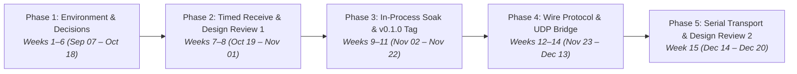

# Project Beacon: Work Breakdown Structure (WBS) & Fall 2026 Schedule
## Comprehensive Task Catalog, Ownership & Dependency Tree (Weeks 1–15: Sep 07 – Dec 20, 2026)

**Project:** Beacon: Typed Publish-Subscribe Messaging Library in Ada  
**Course:** STG-455: Capstone Project I — Grand Canyon University  
**Sponsor:** AdaCore (GNAT Academic Program - GAP)  
**Engineering Team:**  
* **Hovan Hodges:** Core Systems Engineer *(Architecture, Generics & Formal Proofs)*  
* **Ryan Tomasko:** Security & Validation Engineer *(Security Hardening, Unit/Soak Testing, Invariants & Verification)*  
* **Praise Jibunor:** Network Systems Engineer *(Wire Framing, Transports, Multicast & Bridges)*  
**Repository:** [`GCU-beacon`](..)  

---

## Executive Summary of Phases

---

## Detailed Task Breakdown & Ownership

### Phase 1: Environment Setup & Design Decisions (Weeks 1–6: Sep 07 – Oct 18, 2026)

* **Task 1.1: Toolchain Setup & Build Verification**
  * **Lead Engineer:** Hovan Hodges (Core Systems Engineer) with Full Team
  * **Description:** Install and configure the native Ada development environment, verifying builds using the Alire package manager and GNAT 2022 compiler toolchain.
  * **Resources Required:** Alire 2.1+ package manager; native GNAT 2022 compiler toolchain (`gnat_native 14+`); GitHub repository ([`GCU-beacon`](..)).
  * **Time Needed:** 6 hours (2 hrs/member across 3 team members) | **Duration:** 1 week (Sep 28 – Oct 04, 2026).
  * **Costs Associated:** \$0.
  * **Predecessors & Successors:**
    * *Predecessors:* None (Project Initiation).
    * *Successors:* Task 1.2, Task 1.3.

* **Task 1.2: Audit Seed Repository**
  * **Lead Engineer:** Hovan Hodges (Core Systems Engineer)
  * **Description:** Perform initial code review and baseline audit of the provided Ada seed codebase to verify generic packaging, zero-heap constraints, and baseline test suite.
  * **Resources Required:** Native GNAT 2022 compiler toolchain (`gnat_native 14+`); GitHub repository ([`GCU-beacon`](..)); Visual Studio Code.
  * **Time Needed:** 20 hours | **Duration:** 2 weeks (Sep 28 – Oct 11, 2026).
  * **Costs Associated:** \$0.
  * **Predecessors & Successors:**
    * *Predecessors:* Task 1.1.
    * *Successors:* Task 1.3.

* **Task 1.3: Resolve Open Design Decisions**
  * **Lead Engineer:** Full Engineering Team (Hovan Hodges, Ryan Tomasko, Praise Jibunor)
  * **Description:** Conduct stakeholder trade study consultations with Olivier Henley (AdaCore) and Steven Faulkner (GCU) to resolve open architectural decisions (e.g. timed receive, publisher registry lockdown, configurable `Try_Publish` policy).
  * **Resources Required:** Ada 2022 Reference Manual; OMG DDS v1.4 Specification; [`ARCHITECTURE.md`](../ARCHITECTURE.md).
  * **Time Needed:** 12 hours (4 hrs/member across 3 team members) | **Duration:** 2 weeks (Oct 05 – Oct 18, 2026).
  * **Costs Associated:** \$0.
  * **Predecessors & Successors:**
    * *Predecessors:* Task 1.1, Task 1.2.
    * *Successors:* Task 2.1, Task 2.2, Milestone 1.

---

### Phase 2: Timed Receive & Design Review Presentation (Weeks 7–8: Oct 19 – Nov 01, 2026)

* **Task 2.1: Implement Timed Receive in Topic Body**
  * **Lead Engineer:** Hovan Hodges (Core Systems Engineer)
  * **Description:** Implement non-infinite `Receive` procedure with timeout using `Ada.Real_Time.Time_Span`, preventing subscriber task starvation.
  * **Resources Required:** GNAT 2022 compiler; Ada tasking runtime; [`src/beacon-topic.ads`](../src/beacon-topic.ads) and [`src/beacon-topic.adb`](../src/beacon-topic.adb); Visual Studio Code.
  * **Time Needed:** 12 hours | **Duration:** 1 week (Oct 19 – Oct 25, 2026).
  * **Costs Associated:** \$0.
  * **Predecessors & Successors:**
    * *Predecessors:* Task 1.3.
    * *Successors:* Task 2.2, Task 2.3.

* **Task 2.2: Timed Receive Unit Tests & Timeout Checks**
  * **Lead Engineer:** Praise Jibunor (Network Systems Engineer)
  * **Description:** Create dedicated automated unit test cases in the Ada unit test executable validating timeout expiration, successful item retrieval, and timeout unblocking behavior.
  * **Resources Required:** Unit test framework; [`tests/src/topic_tests.adb`](../tests/src/topic_tests.adb); Visual Studio Code.
  * **Time Needed:** 12 hours | **Duration:** 1 week (Oct 19 – Oct 25, 2026).
  * **Costs Associated:** \$0.
  * **Predecessors & Successors:**
    * *Predecessors:* Task 1.3, Task 2.1.
    * *Successors:* Task 2.3.

* **Milestone 1: Design Review Presentation 1**
  * **Lead Engineer:** Full Engineering Team
  * **Description:** Deliver formal 15-minute Design Review Presentation covering design concepts, requirements traceability, and Pugh architectural trade study to faculty and mentors.
  * **Resources Required:** Microsoft PowerPoint; Presentation Slides ([`docs/PRESENTATION_SLIDES.md`](PRESENTATION_SLIDES.md)).
  * **Time Needed:** 8 hours | **Duration:** 4 days (Oct 19 – Oct 22, 2026).
  * **Costs Associated:** \$0.
  * **Predecessors & Successors:**
    * *Predecessors:* Task 1.3.
    * *Successors:* Task 2.3.
  * **Schedule note (11/06/2026):** the presentation on Oct 22 covered the design from Task 1.3. Tasks 2.1 and 2.2 finished on Oct 25, after it, so they are no longer listed as its predecessors.

* **Task 2.3: Harden Protected Queue Entry Barriers**
  * **Lead Engineer:** Hovan Hodges (Core Systems Engineer)
  * **Description:** Audit and harden Ada Protected Object entry barriers with Ceiling Priority Protocol, verifying thread synchronization and boundary safety under high task concurrency.
  * **Resources Required:** GNAT tasking runtime with Ceiling Priority Protocol; GDB debugger; [`src/beacon-topic.adb`](../src/beacon-topic.adb); Visual Studio Code.
  * **Time Needed:** 10 hours | **Duration:** 1 week (Oct 26 – Nov 01, 2026).
  * **Costs Associated:** \$0.
  * **Predecessors & Successors:**
    * *Predecessors:* Task 2.1, Milestone 1.
    * *Successors:* Task 2.4, Task 3.1.

* **Task 2.4: Implement Multi-Task Blocking-Publish Test**
  * **Lead Engineer:** Praise Jibunor (Network Systems Engineer)
  * **Description:** Implement multi-threaded test runner verifying that publisher tasks block on saturated reliable subscriber queues and properly resume upon consumer drain without memory loss.
  * **Resources Required:** Multi-threaded test runner; [`tests/src/topic_tests.adb`](../tests/src/topic_tests.adb); atomic synchronization primitives; Visual Studio Code.
  * **Time Needed:** 16 hours | **Duration:** 1 week (Oct 26 – Nov 01, 2026).
  * **Costs Associated:** \$0.
  * **Predecessors & Successors:**
    * *Predecessors:* Task 2.3.
    * *Successors:* Task 3.1.
  * **⚠ Code Review Changes Required (11/06/2026):**
    * Replace the open TODO at [`tests/src/topic_tests.adb`](../tests/src/topic_tests.adb) line 102: a publisher task calls `Publish` on a full `Reliable` subscriber, the test confirms it is blocked, drains one message, then confirms it resumes and `Dropped (Rel) = 0`.
    * This is currently the only check of the Task 2.3 Ceiling Priority Protocol work under real contention. All existing topic tests run in a single task.

---

### Phase 3: In-Process Soak & Demo Release (Weeks 9–11: Nov 02 – Nov 22, 2026)

* **Task 3.1: Verify Best-Effort Drop-Oldest**
  * **Lead Engineer:** Hovan Hodges (Core Systems Engineer)
  * **Description:** Verify ring buffer overwrite-oldest pointer arithmetic in [`src/beacon-queue.adb`](../src/beacon-queue.adb) to guarantee accurate drop counting and zero corruption. Paper inductive proof written and Ada `Type_Invariant` contract checked at runtime; `gnatprove --mode=all` on the [`prove/prove.gpr`](../prove/prove.gpr) harness (run in CI) proves all 71/71 `Beacon.Queue` checks (absence of runtime errors for every `Depth`, i.e. SPARK Silver; the ring type invariant including buffer initialization via `Relaxed_Initialization`, and `Count` contracts); FIFO element ordering is tested, not proven (see [`docs/TASK_3_1_VERIFICATION_REPORT.md`](TASK_3_1_VERIFICATION_REPORT.md)).
  * **Resources Required:** GNAT tracing utilities; GNATprove; [`src/beacon-queue.adb`](../src/beacon-queue.adb); Visual Studio Code.
  * **Time Needed:** 12 hours | **Duration:** 1 week (Nov 02 – Nov 08, 2026).
  * **Costs Associated:** \$0.
  * **Predecessors & Successors:**
    * *Predecessors:* Task 2.3, Task 2.4.
    * *Successors:* Task 3.2.

* **Task 3.2: Drop-Oldest Invariant & Property Tests**
  * **Lead Engineer:** Ryan Tomasko (Security & Validation Engineer)
  * **Description:** Build property-based randomized test generators to stress test ring buffer wrap-around, head/tail consistency, and FIFO sequence preservation.
  * **Resources Required:** Property-based randomized test generator; multi-core test host; [`tests/src/`](../tests/src); Visual Studio Code.
  * **Time Needed:** 16 hours | **Duration:** 1 week (Nov 02 – Nov 08, 2026).
  * **Costs Associated:** \$0.
  * **Predecessors & Successors:**
    * *Predecessors:* Task 3.1.
    * *Successors:* Task 3.3.

* **Task 3.3: Multi-Task Sustained Soak Stress Test**
  * **Lead Engineer:** Ryan Tomasko (Security & Validation Engineer)
  * **Description:** Subject the in-process core to sustained high-frequency load (e.g. 1 kHz publish rate) to verify memory stability, zero latency spikes, and the invariant `Dropped(Reliable) = 0`.
  * **Resources Required:** High-load multi-threaded test environment; CPU utilization monitor; [`tests/src/topic_tests.adb`](../tests/src/topic_tests.adb); Visual Studio Code.
  * **Time Needed:** 20 hours | **Duration:** 1 week (Nov 09 – Nov 15, 2026).
  * **Costs Associated:** \$0.
  * **Predecessors & Successors:**
    * *Predecessors:* Task 3.2.
    * *Successors:* Task 3.4, Task 3.5.

* **Task 3.4: Zero-Heap & Embedded Jorvik Audit**
  * **Lead Engineer:** Hovan Hodges (Core Systems Engineer)
  * **Description:** Profile core memory footprint using `gnatmem` and verify zero dynamic allocation in `src/` to ensure full compliance with the Ada Jorvik profile.
  * **Resources Required:** GNAT Jorvik embedded runtime; `gnatmem` heap profiling utility; `-fstack-check` compiler diagnostics; [`beacon.gpr`](../beacon.gpr); Visual Studio Code.
  * **Time Needed:** 24 hours (re-baselined from 16 on 11/06/2026) | **Duration:** 1 week (Nov 09 – Nov 15, 2026).
  * **Costs Associated:** \$0.
  * **Predecessors & Successors:**
    * *Predecessors:* Task 3.3.
    * *Successors:* Task 3.5, Task 3.7.
  * **⚠ Code Review Changes Required (11/06/2026):** This task now needs code changes, not just an audit. A trial compile of `Beacon.Topic` under `pragma Profile (Jorvik)` fails today:
    * **`Pure_Barriers`** at [`src/beacon-topic.adb`](../src/beacon-topic.adb) lines 12 and 43. Both entry barriers call `Ring.Is_Full` / `Ring.Is_Empty`.
      * *Fix:* keep `Full` and `Empty` Boolean components in `Bounded_Queue`, update them in every operation, and make the barriers read only those components and the `Mode` discriminant.
    * **`No_Select_Statements`** at [`src/beacon-topic.adb`](../src/beacon-topic.adb) line 137. The timed `Receive` added in Task 2.1 uses `select ... or delay`.
      * *Fix (decided 11/06/2026):* move the timed `Receive` into a full-tasking child package, `Beacon.Topic.Timed`, so the core `Beacon.Topic` compiles under Jorvik and desktop builds keep the feature. Move the Task 2.2 timeout tests to the child package and keep them passing. Update the callers (tests, demos, and the Task 4.4 egress).
    * **Ravenscar is out of reach as designed:** `Bounded_Queue` has two entries (`Max_Protected_Entries = 1`). Record Jorvik as the supported light-tasking profile.
    * **Regression guard:** add a CI step that compiles the core units (`src/` with `BEACON_NETWORK=no`, excluding `Beacon.Topic.Timed`) using a configuration file containing `pragma Profile (Jorvik);`. A plain compile on the native toolchain is enough, so the check does not need the embedded runtime.
    * When the fix lands, update the "Runtime needs" comment in [`src/beacon-topic.ads`](../src/beacon-topic.ads) and the light-tasking note in [`ARCHITECTURE.md`](../ARCHITECTURE.md).
    * The `gnatmem` and zero-heap scope stays as planned. The estimate was raised from 16 to 24 hours on 11/06/2026 to cover these code changes.

* **Task 3.5: Expand Flight Telemetry Demo**
  * **Lead Engineer:** Praise Jibunor (Network Systems Engineer)
  * **Description:** Enhance the in-process demonstration app with multi-rate telemetry topics simulating satellite flight instruments and control loops.
  * **Resources Required:** Flight simulation models; [`demo/src/inproc_demo.adb`](../demo/src/inproc_demo.adb) and [`demo/src/telemetry.ads`](../demo/src/telemetry.ads); Visual Studio Code.
  * **Time Needed:** 20 hours | **Duration:** 1 week (Nov 16 – Nov 22, 2026).
  * **Costs Associated:** \$0.
  * **Predecessors & Successors:**
    * *Predecessors:* Task 3.3, Task 3.4.
    * *Successors:* Task 3.6, Milestone 2.

* **Task 3.6: Tag In-Process Release v0.1.0-inproc**
  * **Lead Engineer:** Full Engineering Team (Lead: Hovan Hodges)
  * **Description:** Package and tag the verified in-process core release in Git, establishing the milestone baseline for subsequent network transports.
  * **Resources Required:** Git version control.
  * **Time Needed:** 14 hours | **Duration:** 1 week (Nov 16 – Nov 22, 2026).
  * **Costs Associated:** \$0.
  * **Predecessors & Successors:**
    * *Predecessors:* Task 3.5, Task 3.7.
    * *Successors:* Task 4.1, Milestone 2.

* **Task 3.7: Subscriber Lifecycle & Registry Lockdown**
  * **Lead Engineer:** Hovan Hodges (Core Systems Engineer)
  * **Description:** Add registry lockdown (FR-07) and a startup/shutdown-only `Delete_Subscriber`, so the subscriber registry is static once publishing begins and can never hold a dangling access value.
  * **Resources Required:** GNAT 2022 compiler; [`src/beacon-topic.ads`](../src/beacon-topic.ads) and [`src/beacon-topic.adb`](../src/beacon-topic.adb); [`tests/src/topic_tests.adb`](../tests/src/topic_tests.adb); Visual Studio Code.
  * **Time Needed:** 12 hours | **Duration:** 1 week (Nov 16 – Nov 22, 2026).
  * **Costs Associated:** \$0.
  * **Predecessors & Successors:**
    * *Predecessors:* Task 3.4.
    * *Successors:* Task 3.6, Task 4.4.
  * **Added 11/06/2026 from the code review** (items U-1 and U-2 in [`UNSCHEDULED_CHANGES_REPORT.md`](UNSCHEDULED_CHANGES_REPORT.md)):
    * **Registry lockdown (FR-07, Open Decision #2):** add a package-level `Locked` flag, set by the first `Publish` or `Try_Publish`, an `Is_Locked` query, and `Pre => not Is_Locked` on `Create_Subscriber`. This keeps design rule 4 (static configuration) and makes the "register before any `Publish`" rule checkable.
    * **Unregister (Open Decision #4):** add `Delete_Subscriber (S : in out Subscriber)` with `Pre => Is_Registered (S) and then not Is_Locked`. It removes `S` from the registry and closes the gap. It is for startup and shutdown only: once the registry is locked, subscribers live until the program ends.
    * Tests in `topic_tests`: `Create_Subscriber` after the first `Publish` fails its precondition, and a subscriber can be deleted and its slot reused before the lock.
    * Starts after Task 3.4 because both change `src/beacon-topic.adb`. Ships in `v0.1.0-inproc` (Task 3.6).

* **Milestone 2: In-Process Backend Demo**
  * **Lead Engineer:** Full Engineering Team
  * **Description:** Formal live demonstration of the in-process publish-subscribe architecture to project sponsors and faculty advisors.
  * **Resources Required:** Visual Studio Code; Google Meet.
  * **Time Needed:** 4 hours | **Duration:** 1 week (Nov 16 – Nov 22, 2026).
  * **Costs Associated:** \$0.
  * **Predecessors & Successors:**
    * *Predecessors:* Task 3.5, Task 3.6.
    * *Successors:* Task 4.1.

---

### Phase 4: Wire Protocol & UDP Prototype (Weeks 12–14: Nov 23 – Dec 13, 2026)

* **Task 4.1: Wire Header Representation Clauses Layout**
  * **Lead Engineer:** Praise Jibunor (Network Systems Engineer)
  * **Description:** Define exact binary layout of 14-byte frame header using Ada representation clauses to enforce cross-platform endianness and alignment.
  * **Resources Required:** System package endianness constants; IEEE 802.3 CRC-32 specification; [`src/net/beacon-wire.ads`](../src/net/beacon-wire.ads); Visual Studio Code.
  * **Time Needed:** 18 hours | **Duration:** 1 week (Nov 23 – Nov 29, 2026).
  * **Costs Associated:** \$0.
  * **Predecessors & Successors:**
    * *Predecessors:* Task 3.6, Milestone 2.
    * *Successors:* Task 4.2, Task 4.2b, Task 4.3.
  * **⚠ Code Review Changes Required (11/06/2026):**
    * `Beacon.Wire.Header` reports `Alignment = 4`, but it is overlaid on `Byte_Array` slices that can start at any byte. It works on x86, but it is not portable to targets that require aligned access.
      * *Fix:* add `Alignment => 1` to `Header` (and to `Telemetry.Reading` in the demo codec if it reports more than 1), then confirm that `Header'Size` is still 112.

* **Task 4.2: Wire Framing & CRC-32 Unit Test Suite**
  * **Lead Engineer:** Ryan Tomasko (Security & Validation Engineer)
  * **Description:** Implement automated test suite verifying representation clause packing, unpacking, and IEEE 802.3 CRC-32 bit-flip rejection.
  * **Resources Required:** Automated test runner; CRC test vectors; [`tests/src/wire_tests.adb`](../tests/src/wire_tests.adb); Visual Studio Code.
  * **Time Needed:** 16 hours | **Duration:** 1 week (Nov 23 – Nov 29, 2026).
  * **Costs Associated:** \$0.
  * **Predecessors & Successors:**
    * *Predecessors:* Task 4.1.
    * *Successors:* Task 4.3.
  * **⚠ Code Review Changes Required (11/06/2026):** [`tests/src/wire_tests.adb`](../tests/src/wire_tests.adb) has no test for:
    * `Bad_Magic`;
    * a datagram with trailing bytes past the declared `Length`, which must give `Bad_Length`;
    * a payload of exactly `Max_Payload` (1024 bytes), and an invalid `Length` field value (above 1024);
    * a frame whose slice starts at an odd index, which guards the Task 4.1 alignment fix;
    * a `Telemetry.Codecs` round trip, and rejection when `'Valid_Scalars` fails.

* **Task 4.2b: In-Memory Loopback Transport & Bridge Tests**
  * **Lead Engineer:** Ryan Tomasko (Security & Validation Engineer)
  * **Description:** Build an in-memory loopback transport and a single-process bridge test suite, so bridge behaviour and counters can be checked deterministically without UDP multicast.
  * **Resources Required:** [`src/net/beacon-transport.ads`](../src/net/beacon-transport.ads); [`src/net/beacon-bridge.adb`](../src/net/beacon-bridge.adb); [`tests/src/`](../tests/src); Visual Studio Code.
  * **Time Needed:** 10 hours | **Duration:** 1 week (Nov 23 – Nov 29, 2026).
  * **Costs Associated:** \$0.
  * **Predecessors & Successors:**
    * *Predecessors:* Task 4.1.
    * *Successors:* Task 4.4.
  * **Added 11/06/2026 from the code review** (item U-4 in [`UNSCHEDULED_CHANGES_REPORT.md`](UNSCHEDULED_CHANGES_REPORT.md)):
    * Add `Beacon.Transport.Loopback`: a bounded in-memory frame queue that implements `Send` and `Receive (Timeout)`, so bridge tests do not depend on UDP multicast.
    * Add `tests/src/bridge_tests.adb`: run egress and ingress in one process over the loopback and check the counters exactly. Include a fault-injection transport that raises on `Receive`.
    * Must be ready before Task 4.4, so each bridge fix lands with a deterministic test.

* **Task 4.3: GNAT.Sockets UDP Multicast Transport Tuning**
  * **Lead Engineer:** Praise Jibunor (Network Systems Engineer)
  * **Description:** Implement and tune UDP multicast socket transport using `GNAT.Sockets`, verifying non-blocking socket options and loopback membership.
  * **Resources Required:** `GNAT.Sockets` package; local loopback multicast routing; [`src/net/beacon-transport-udp.adb`](../src/net/beacon-transport-udp.adb); Visual Studio Code.
  * **Time Needed:** 16 hours | **Duration:** 1 week (Nov 30 – Dec 06, 2026).
  * **Costs Associated:** \$0.
  * **Predecessors & Successors:**
    * *Predecessors:* Task 4.1, Task 4.2.
    * *Successors:* Task 4.4.
  * **⚠ Code Review Changes Required (11/06/2026):** in [`src/net/beacon-transport-udp.adb`](../src/net/beacon-transport-udp.adb):
    * `Receive` creates and closes a `Selector_Type` on every call, which on GNAT means a new internal socket pair 10 times per second per ingress. Create the selector once in `Open` and close it in `Close`, or use a socket receive timeout instead.
    * `Open` leaks the socket if `Bind_Socket` or a `Set_Socket_Option` call raises. Close it in an exception handler and re-raise.
    * `Receive_Socket` can raise `Socket_Error` even after the selector reports data. On Windows, an ICMP "port unreachable" from an earlier send shows up as `WSAECONNRESET`. Decide whether `Receive` absorbs that (returning `Count = 0`) or reports it to the bridge; see Task 4.4.
    * `Send` copies the frame twice, into a zeroed buffer and then through `Unchecked_Conversion`. One overlay is enough.

* **Task 4.4: Bridge Egress & Ingress Task Integration**
  * **Lead Engineer:** Praise Jibunor (Network Systems Engineer) & Hovan Hodges (Core Systems Engineer)
  * **Description:** Integrate bridge tasks connecting local protected topic queues to UDP transport: Egress (local sub -> wire) and Ingress (wire -> local pub).
  * **Resources Required:** Ada tasking runtime; [`src/net/beacon-bridge.ads`](../src/net/beacon-bridge.ads) and [`src/net/beacon-bridge.adb`](../src/net/beacon-bridge.adb); Visual Studio Code.
  * **Time Needed:** 18 hours | **Duration:** 1 week (Nov 30 – Dec 06, 2026).
  * **Costs Associated:** \$0.
  * **Predecessors & Successors:**
    * *Predecessors:* Task 3.7, Task 4.2b, Task 4.3.
    * *Successors:* Task 4.5.
  * **⚠ Code Review Changes Required (11/06/2026):** in [`src/net/beacon-bridge.adb`](../src/net/beacon-bridge.adb):
    * **Registration race (bug):** `Create_Subscriber` and `Create_Publisher` run after the `accept Start` finishes, so they run alongside the caller. `Start_Egress` returns before the egress subscriber is registered. This breaks the "register before any `Publish`, from one task" rule:
      * `net_publisher` can lose its first readings;
      * two registrations at once can collide on `Registered`;
      * the `Pre` on `Start_Egress` checks a count that is out of date.
      * *Fix:* move both calls inside the `accept` body. With the Task 3.7 lockdown, `Start_Egress` must also run before the first `Publish`; the precondition on `Create_Subscriber` now enforces that.
    * **Use after free once `Stop` is called (bug):** the egress `Sub` lives on the task's stack, but the topic registry keeps an access value to it after the task ends. Any later `Publish` uses freed memory, and a `Reliable` egress that nobody drains blocks the publisher forever.
      * *Fix (decided 11/06/2026):* declare the egress subscriber at library level inside the bridge body, so the registry never points at freed memory. After `Stop`, the egress task keeps draining and discarding messages instead of ending, so a `Reliable` egress can never block the publisher. `Subscriber` is discriminated by `Mode`, so the egress `Mode` moves from `Start_Egress` to a generic formal of `Beacon.Bridge`. The Task 3.7 `Delete_Subscriber` cannot be used here, because the registry is locked by the time `Stop` runs.
    * **Tasks die silently (bug):** neither task body has an exception handler. A `Socket_Error` (see Task 4.3) or a `Constraint_Error` from a user `Serialize` stops the task, and nothing records it.
      * *Fix:* add handlers that record the failure (a status function or counter) and, for egress, keep draining, so a `Reliable` publisher cannot be blocked.
    * **Lost ingress messages are not counted:** the `Accepted` result of `Try_Publish` is ignored, so a message dropped because a local `Reliable` subscriber was full is never counted. Add a counter next to `Rejected_Frames` and `Sequence_Gaps`.
    * **No guard on a second start:** a second `Start_Egress` or `Start_Ingress` silently replaces the first task. Add `Pre` conditions or a state check.
    * `Rejected` and `Gaps` use plain `+ 1` and will raise `Constraint_Error` after 2³¹ events. Saturate them as `Drops` is.
    * Egress busy-polls with a 1 ms delay. The bridge is desktop-only (full runtime), so egress can block on the timed `Receive` from `Beacon.Topic.Timed` (Task 3.4) instead, which removes the polling and the added latency.
    * Test each fix with the loopback transport and `bridge_tests` from Task 4.2b.

* **Task 4.5: Implement Cross-Process UDP Publish-Receive**
  * **Lead Engineer:** Praise Jibunor (Network Systems Engineer)
  * **Description:** Implement two standalone CLI executables demonstrating bidirectional typed message flow across independent OS desktop processes.
  * **Resources Required:** 2 terminal processes on host; [`demo/src/net_publisher.adb`](../demo/src/net_publisher.adb) and [`demo/src/net_subscriber.adb`](../demo/src/net_subscriber.adb); Visual Studio Code.
  * **Time Needed:** 18 hours | **Duration:** 1 week (Dec 07 – Dec 13, 2026).
  * **Costs Associated:** \$0.
  * **Predecessors & Successors:**
    * *Predecessors:* Task 4.4.
    * *Successors:* Task 4.6, Milestone 3.

* **Task 4.6: Headless Cross-Process CI Verification Test**
  * **Lead Engineer:** Ryan Tomasko (Security & Validation Engineer)
  * **Description:** Author automated GitHub Actions CI step executing cross-process publisher and subscriber binaries, asserting 0 dropped frames and 0 sequence gaps.
  * **Resources Required:** GitHub Actions Ubuntu/Windows runners; bash/PowerShell automation scripts; [`.github/workflows/ci.yml`](../.github/workflows/ci.yml); Visual Studio Code.
  * **Time Needed:** 16 hours | **Duration:** 1 week (Dec 07 – Dec 13, 2026).
  * **Costs Associated:** \$0.
  * **Predecessors & Successors:**
    * *Predecessors:* Task 4.5.
    * *Successors:* Task 5.1, Milestone 3.
  * **⚠ Code Review Changes Required (11/06/2026):** the current CI UDP step (`grep -q "done, 200 readings"`) can fail intermittently. The cause is the Task 4.4 registration race (the first readings are published before the egress subscriber exists), not UDP loss. Land the Task 4.4 fix first, then assert on the counters (`Sequence_Gaps`, rejected frames, and the new ingress-drop counter), not on a fixed total.

* **Milestone 3: Cross-Process UDP Demo**
  * **Lead Engineer:** Full Engineering Team
  * **Description:** Live demonstration of multi-process typed UDP multicast communication with simulated packet loss detection.
  * **Resources Required:** Visual Studio Code; Google Meet.
  * **Time Needed:** 6 hours | **Duration:** 1 week (Dec 07 – Dec 13, 2026).
  * **Costs Associated:** \$0.
  * **Predecessors & Successors:**
    * *Predecessors:* Task 4.5, Task 4.6.
    * *Successors:* Task 5.1, Milestone 4.

---

### Phase 5: Serial Transport & Fall Finish (Week 15: Dec 14 – Dec 20, 2026)

* **Task 5.1: Serial Transport Architecture & Stream Framing**
  * **Lead Engineer:** Praise Jibunor (Network Systems Engineer)
  * **Description:** Design byte-stream point-to-point framing using Consistent Overhead Byte Stuffing (COBS) or SLIP framing for serial UART interfaces.
  * **Resources Required:** COBS/SLIP framing algorithms; serial interface specifications; [`src/net/`](../src/net); Visual Studio Code.
  * **Time Needed:** 22 hours | **Duration:** 1 week (Dec 14 – Dec 20, 2026).
  * **Costs Associated:** \$0.
  * **Predecessors & Successors:**
    * *Predecessors:* Task 4.6, Milestone 3.
    * *Successors:* Task 5.2.

* **Task 5.2: Serial Virtual Port Loopback & Recovery Tests**
  * **Lead Engineer:** Ryan Tomasko (Security & Validation Engineer) & Praise Jibunor (Network Systems Engineer)
  * **Description:** Test serial framing across virtual null-modem serial ports (`socat` / `com0com`), injecting line noise and verifying automatic re-synchronization.
  * **Resources Required:** Virtual serial port emulator (`socat` / `com0com`); noise injection harness.
  * **Time Needed:** 18 hours | **Duration:** 1 week (Dec 14 – Dec 20, 2026).
  * **Costs Associated:** \$0.
  * **Predecessors & Successors:**
    * *Predecessors:* Task 5.1.
    * *Successors:* Spring Semester (Phase 6).

* **Milestone 4: Design Review Presentation 2**
  * **Lead Engineer:** Full Engineering Team
  * **Description:** Deliver Fall Semester Final Review Presentation recapping in-process and network transports to faculty and AdaCore sponsors.
  * **Resources Required:** Microsoft PowerPoint.
  * **Time Needed:** 8 hours | **Duration:** 4 days (Dec 14 – Dec 18, 2026).
  * **Costs Associated:** \$0.
  * **Predecessors & Successors:**
    * *Predecessors:* Milestone 3.
    * *Successors:* Spring Semester (Phase 6: SPARK Silver Proof & Alire Distribution).
  * **Schedule note (11/06/2026):** the presentation on Dec 18 comes before Tasks 5.1 and 5.2 end on Dec 20, so it follows Milestone 3 and presents the serial transport as work in progress.

---

## Complete Traceability & Schedule Matrix

| Phase | Task ID | Task Description | Lead Engineer | Hours | Start Date | End Date | Dependencies |
| :---: | :---: | :--- | :--- | :---: | :---: | :---: | :--- |
| **P1** | **Task 1.1** | Toolchain Setup & Build Verification | Hovan Hodges / Team | 6 | 2026-09-28 | 2026-10-04 | None |
| **P1** | **Task 1.2** | Audit Seed Repository | Hovan Hodges | 20 | 2026-09-28 | 2026-10-11 | Task 1.1 |
| **P1** | **Task 1.3** | Resolve Open Design Decisions | Team (All) | 12 | 2026-10-05 | 2026-10-18 | Task 1.1, Task 1.2 |
| **P2** | **Task 2.1** | Implement Timed Receive in Topic Body | Hovan Hodges | 12 | 2026-10-19 | 2026-10-25 | Task 1.3 |
| **P2** | **Task 2.2** | Timed Receive Unit Tests & Timeout Checks | Praise Jibunor | 12 | 2026-10-19 | 2026-10-25 | Task 1.3, Task 2.1 |
| **P2** | **M1** | **Design Review Presentation 1** | **Team (All)** | **8** | **2026-10-19** | **2026-10-22** | **Task 1.3** |
| **P2** | **Task 2.3** | Harden Protected Queue Entry Barriers | Hovan Hodges | 10 | 2026-10-26 | 2026-11-01 | Task 2.1, M1 |
| **P2** | **Task 2.4** | Multi-Task Blocking-Publish Test | Praise Jibunor | 16 | 2026-10-26 | 2026-11-01 | Task 2.3 |
| **P3** | **Task 3.1** | Verify Best-Effort Drop-Oldest | Hovan Hodges | 12 | 2026-11-02 | 2026-11-08 | Task 2.3, Task 2.4 |
| **P3** | **Task 3.2** | Drop-Oldest Invariant & Property Tests | Ryan Tomasko | 16 | 2026-11-02 | 2026-11-08 | Task 3.1 |
| **P3** | **Task 3.3** | Multi-Task Sustained Soak Stress Test | Ryan Tomasko | 20 | 2026-11-09 | 2026-11-15 | Task 3.2 |
| **P3** | **Task 3.4** | Zero-Heap & Embedded Jorvik Audit | Hovan Hodges | 24 | 2026-11-09 | 2026-11-15 | Task 3.3 |
| **P3** | **Task 3.5** | Expand Flight Telemetry Demo | Praise Jibunor | 20 | 2026-11-16 | 2026-11-22 | Task 3.3, Task 3.4 |
| **P3** | **Task 3.6** | Tag In-Process Release v0.1.0-inproc | Hovan Hodges / Team | 14 | 2026-11-16 | 2026-11-22 | Task 3.5, Task 3.7 |
| **P3** | **Task 3.7** | Subscriber Lifecycle & Registry Lockdown | Hovan Hodges | 12 | 2026-11-16 | 2026-11-22 | Task 3.4 |
| **P3** | **M2** | **In-Process Backend Demo** | **Team (All)** | **4** | **2026-11-16** | **2026-11-22** | **Task 3.5, Task 3.6** |
| **P4** | **Task 4.1** | Wire Header Representation Clauses | Praise Jibunor | 18 | 2026-11-23 | 2026-11-29 | Task 3.6, M2 |
| **P4** | **Task 4.2** | Wire Framing & CRC-32 Unit Tests | Ryan Tomasko | 16 | 2026-11-23 | 2026-11-29 | Task 4.1 |
| **P4** | **Task 4.2b** | In-Memory Loopback Transport & Bridge Tests | Ryan Tomasko | 10 | 2026-11-23 | 2026-11-29 | Task 4.1 |
| **P4** | **Task 4.3** | UDP Multicast Transport Tuning | Praise Jibunor | 16 | 2026-11-30 | 2026-12-06 | Task 4.1, Task 4.2 |
| **P4** | **Task 4.4** | Bridge Egress & Ingress Task Integration | Praise Jibunor & Hovan Hodges | 18 | 2026-11-30 | 2026-12-06 | Task 3.7, Task 4.2b, Task 4.3 |
| **P4** | **Task 4.5** | Cross-Process UDP Publish-Receive | Praise Jibunor | 18 | 2026-12-07 | 2026-12-13 | Task 4.4 |
| **P4** | **Task 4.6** | Headless Cross-Process CI Verification | Ryan Tomasko | 16 | 2026-12-07 | 2026-12-13 | Task 4.5 |
| **P4** | **M3** | **Cross-Process UDP Demo** | **Team (All)** | **6** | **2026-12-07** | **2026-12-13** | **Task 4.5, Task 4.6** |
| **P5** | **Task 5.1** | Serial Transport Architecture & Framing | Praise Jibunor | 22 | 2026-12-14 | 2026-12-20 | Task 4.6, M3 |
| **P5** | **Task 5.2** | Serial Port Loopback & Recovery Tests | Ryan Tomasko & Praise Jibunor | 18 | 2026-12-14 | 2026-12-20 | Task 5.1 |
| **P5** | **M4** | **Design Review Presentation 2** | **Team (All)** | **8** | **2026-12-14** | **2026-12-18** | **M3** |
