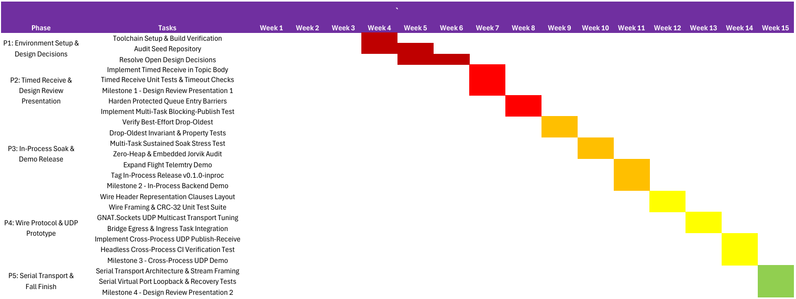
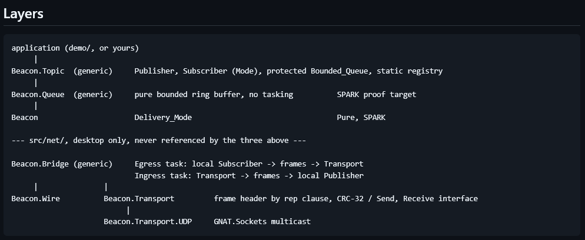

# STG-455 Weekly Status Update: Beacon
## Week 8 Status Report: Timed Receive Implementation & Concurrency Hardening

**Course:** STG-455: Capstone Project I — Grand Canyon University  
**Project:** Beacon: Typed Publish-Subscribe Messaging Library in Ada  
**Reporting Period:** Week 8 (Ending November 01, 2026)  
**Overall Project Progress:** **10% Complete**  
**Engineering Team:**  
* Hovan Hodges (Core Systems Engineer)  
* Ryan Tomasko (Security & Validation Engineer)  
* Praise Jibunor (Network Systems Engineer)  
**Mentor:** Steven Faulkner (GCU Mentor) | **Industry Partner:** Olivier Henley (AdaCore GAP)  
**Repository:** [`GCU-beacon`](../..)  

---

## Project Description

Beacon is a typed publish-subscribe messaging library: topics are Ada generic instantiations, so a subscriber to a `Telemetry_Topic` receives `Telemetry_Reading` values directly, never raw bytes to be cast and hoped about. It provides an in-process bounded-queue backend for single-application use and a network backend for cross-process communication on desktop.

---

## Project Status Summary

**Percent Complete: 10%**  
During Week 8, the team progressed through Phase 2 by achieving code completion for bounded subscriber semantics, successfully implementing and verifying the overloaded timed `Receive` procedure with `Ada.Real_Time.Time_Span` timeouts in [`src/beacon-topic.ads`](../../src/beacon-topic.ads) and [`src/beacon-topic.adb`](../../src/beacon-topic.adb) to formally resolve Open Design Decision #3. With core timed reception in place, the team is now closer to finalizing Phase 2 by hardening Ada Protected Object entry barriers under the Ceiling Priority Protocol and implementing multi-threaded blocking-publish verification tests in preparation for Phase 3 soak testing.

---

## Timeline Snapshot

The timeline snapshot below illustrates the phased engineering schedule for Project Beacon, translating AdaCore's overarching 32-week lifecycle roadmap into the team's 15-week Fall 2026 execution matrix across five sequential phases.

  
*Figure 1. GANTT Chart of Tasks for Fall 2026 Semester.*

---

## Current Concept

  
*Figure 2. Current Design/Architecture Concept Layering.*

The team was provided with architecture design for Beacon from AdaCore to follow. The current concept has remained unchanged.

---

## Accomplishments and Learning

* **Hovan Hodges:**
  * Implement Timed Receive in Topic Body (Accomplished)
  * Implement Hardened Protected Queue Entry Barriers (In Progress)
* **Praise Jibunor:**
  * Implement Timed Receive Unit Tests & Timeout Checks (In Progress)
* **Ryan Tomasko:**
  * Complete Project Portfolio (In Progress)
* **Team:**
  * Meet with Olivier Henley (AdaCore contact) to go over Ada specifics in the Beacon seed repository (In Progress)
  * Resubmit the order form correctly (Accomplished)

---

## Work Planned for Next Week

* **Hovan Hodges:**
  * Verify Best-Effort Drop-Oldest (Task 3.1)
* **Praise Jibunor:**
  * Implement Multi-Task Blocking-Publish Test (Task 2.4)
* **Ryan Tomasko:**
  * Drop-Oldest Invariant & Property Tests (Task 3.2)
* **Team:**
  * Compile October Expense Report

---

## Risks

* **Personnel / Roster Transition (Resolved):** Ryan Tomasko & Praise Jibunor have absorbed the Validation duties of our previous Capstone member, stabilizing team velocity under the 3-engineer structure.
* **Technical Concurrency & Barrier Synchronization (Monitored):** The primary technical risk is multi-task synchronization, specifically ensuring that blocking publish calls do not induce deadlocks or priority inversions during consumer drains.

---

## Deliverables and Milestones

### Milestones
| Milestone | Planned | Forecasted | Actual | Status |
| :--- | :---: | :---: | :---: | :--- |
| Initial Research & Design | 10/04 | 10/04 | 10/04 | **Completed** |
| First meeting with AdaCore contact | 10/14 | 10/14 | 10/14 | **Completed** |
| Design Review Presentation Meeting | 10/22 | 10/22 | 10/22 | **Completed** |
| In-Process Backend Demo | 11/22 | 11/22 | — | **In Progress** |

### Deliverables
| Deliverable | Planned | Forecasted | Actual | Status |
| :--- | :---: | :---: | :---: | :--- |
| Team Members Specific Roles & Responsibilities | 10/08 | 10/08 | 10/08 | **Completed** |
| Research Industry Standards | 10/11 | 10/11 | 10/11 | **Completed** |
| Gather Stakeholder Feedback | 10/15 | 10/15 | 10/15 | **Completed** |
| Create Bill of Materials (BOM) for Software and Cloud-Based Projects | 10/18 | 10/18 | 10/18 | **Completed** |
| Finalize Product Functional Requirements | 10/18 | 10/18 | 10/18 | **Completed** |
| Finalize Project Timeline and Work Breakdown Structure | 10/18 | 10/18 | 10/18 | **Completed** |
| Implement Timed Receive in Topic Body | 10/25 | 10/25 | 10/28 | **Completed** |
| Implement Timed Receive Unit Tests & Timeout Checks | 10/25 | 11/01 | — | **In Progress** |
| Implement Hardened Protected Queue Entry Barriers | 11/01 | 11/01 | — | **In Progress** |
| Complete Project Portfolio | 11/01 | 11/01 | — | **In Progress** |
| Implement Multi-Task Blocking-Publish Test | 11/01 | 11/08 | — | **Not Started** |
| Verify Best-Effort Drop-Oldest | 11/08 | 11/08 | — | **Not Started** |
| Drop-Oldest Invariant & Property Tests | 11/08 | 11/08 | — | **Not Started** |
| Compile October Expense Report | 11/08 | 11/08 | — | **Not Started** |

---

## Attachments
* N/A.

---

## Approvals

| Team Role | Print Name | Approval Status | Date |
| :--- | :--- | :---: | :---: |
| **Faculty Mentor** | Steven Faulkner | Approved | 11/01/2026 |
| **Core Systems Engineer** | Hovan Hodges | Approved | 11/01/2026 |
| **Security & Validation Engineer** | Ryan Tomasko | Approved | 11/01/2026 |
| **Network Systems Engineer** | Praise Jibunor | Approved | 11/01/2026 |
