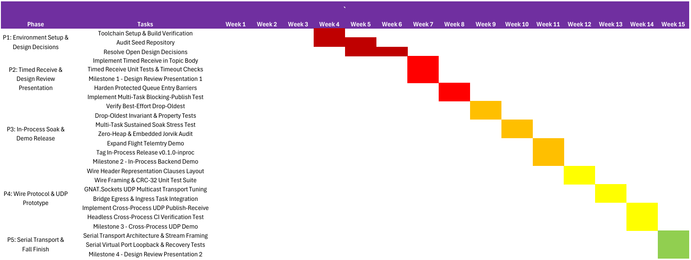
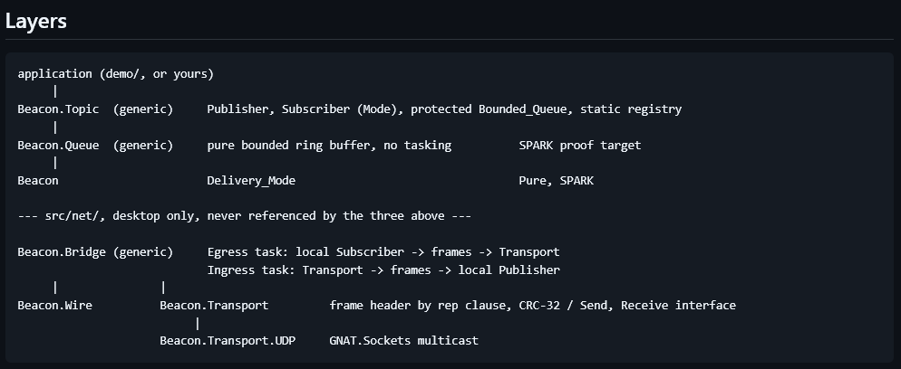

# STG-455 Weekly Status Update: Beacon
## Week 9 Status Report: Barrier Hardening & Ring Buffer Invariant Proofs

**Course:** STG-455: Capstone Project I — Grand Canyon University  
**Project:** Beacon: Typed Publish-Subscribe Messaging Library in Ada  
**Reporting Period:** Week 9 (Ending November 08, 2026)  
**Overall Project Progress:** **13% Complete**  
**Engineering Team:**  
* Hovan Hodges (Core Systems Engineer)  
* Ryan Tomasko (Security & Validation Engineer)  
* Praise Jibunor (Network Systems Engineer)  
**Mentor:** Steven Faulkner (GCU Mentor) | **Industry Partner:** Olivier Henley (AdaCore GAP)  
**Repository:** [`GCU-beacon`](../..)  

---

## 1. Project Description

Beacon is a typed publish-subscribe messaging library: topics are Ada generic instantiations, so a subscriber to a `Telemetry_Topic` receives `Telemetry_Reading` values directly, never raw bytes to be cast and hoped about. It provides an in-process bounded-queue backend for single-application use and a network backend for cross-process communication on desktop.

---

## 2. Project Status Summary

**Percent Complete: 13%**  
During Week 9, the team advanced toward the completion of Phase 2 while initiating early deliverables in Phase 3. Within Phase 2, the team completed **Task 2.3 (Harden Protected Queue Entry Barriers)**: configuring `gnat.adc` with `Ceiling_Locking` and `Priority_Queuing`, binding the `Ceiling_Priority` generic parameter and `Priority` aspect to `Bounded_Queue` in [`src/beacon-topic.ads`](../../src/beacon-topic.ads), and adding arithmetic saturation to drop counters to prevent `Constraint_Error`. Phase 2 remains open as the team actively develops and executes **Task 2.4 (Implement Multi-Task Blocking-Publish Test)** to verify that publisher tasks correctly block on saturated reliable subscriber queues and resume cleanly upon consumer drain. Concurrently, the team achieved an early milestone in Phase 3 by completing **Task 3.1 (Verify Best-Effort Drop-Oldest Pointer Arithmetic)**. An explicit Ada 2022 `Type_Invariant` aspect was integrated into [`src/beacon-queue.ads`](../../src/beacon-queue.ads), backed by defensive assertions and a formal inductive proof report in [`docs/TASK_3_1_VERIFICATION_REPORT.md`](../TASK_3_1_VERIFICATION_REPORT.md). The earlier flow-analysis run turned out to cover nothing, because GNATprove skips generic units. A new proof harness ([`prove/prove.gpr`](../../prove/prove.gpr)) now has GNATprove prove `Beacon.Queue` for every `Depth`: all 71 checks proved (SPARK Silver plus the ring invariant). This required moving the `Type_Invariant` to the full view, adding `Relaxed_Initialization` to the buffer, and removing a latent integer overflow in the index arithmetic. CI now runs this proof. All existing unit test suites (`queue_tests` and `topic_tests`) continue to pass with zero regressions. The team also completed **Task 3.2 (Drop-Oldest Invariant & Property Tests)**: a new randomized suite, [`tests/src/queue_property_tests.adb`](../../tests/src/queue_property_tests.adb), checks FIFO order, drop-oldest behavior, the ring invariant and drop accounting against a reference model over 12 million operations across 12 queue depths, and runs in CI ([`docs/TASK_3_2_VERIFICATION_REPORT.md`](../TASK_3_2_VERIFICATION_REPORT.md)). It covers the FIFO ordering that the Task 3.1 proof leaves out. Velocity remains steady as the team closes Task 2.4 and prepares for sustained 1 kHz multi-task soak tests (Task 3.3) ahead of Milestone 2 (`v0.1.0-inproc`).

---

## 3. Timeline Snapshot

The timeline snapshot below illustrates the engineering schedule for Project Beacon, translating AdaCore's overarching 32-week lifecycle roadmap into the team's 15-week Fall 2026 execution matrix across five sequential phases.

  
*Figure 1. GANTT Chart of Tasks for Fall 2026 Semester.*

Figure 1 exhibits the chronological progression of tasks, dependencies, and critical milestone gates structured across five distinct engineering phases:
* **Phase 1: Environment Setup & Design Decisions (Weeks 1–6, Sep 07 – Oct 18):** Focuses on onboarding, GNAT 2022 toolchain verification with Alire, auditing the Ada seed repository, and resolving open architectural decisions (e.g., timed receive semantics, static subscriber registry lockdown) in consultation with AdaCore and GCU mentors.
* **Phase 2: Timed Receive, Concurrency Hardening & Design Review 1 (Weeks 7–8, Oct 19 – Nov 01):** Focuses on core subscriber synchronization. Major deliverables include delivering Milestone 1 (Design Review Presentation 1), implementing timed `Receive` (blocks until a message arrives or an `Ada.Real_Time.Time_Span` timeout expires), verifying timeout behaviors, and hardening protected entry barriers under the Ceiling Priority Protocol (CPP).
* **Phase 3: In-Process Soak & Demo Release (Weeks 9–11, Nov 02 – Nov 22):** The current operating phase. It targets in-process core validation: formally proving ring buffer pointer arithmetic (Task 3.1), property-based invariant testing (Task 3.2), multi-task sustained soak stress testing at 1 kHz (Task 3.3), and zero-heap Jorvik profile auditing (Task 3.4). This phase concludes at Week 11 with **Milestone 2: In-Process Backend Demo** and the tagging of the `v0.1.0-inproc` release.
* **Phase 4: Wire Protocol & UDP Prototype (Weeks 12–14, Nov 23 – Dec 13):** Transitions Beacon to distributed communication. Tasks encompass defining the 14-byte wire frame header using Ada representation clauses, implementing IEEE 802.3 CRC-32 integrity validation, integrating background Ingress/Egress bridge tasks, and delivering **Milestone 3: Cross-Process UDP Demo**.
* **Phase 5: Serial Transport & Capstone Closure (Week 15, Dec 14 – Dec 20):** Encompasses embedded serial stream framing (COBS) over virtual ports and culminates in the delivery of **Milestone 4: Design Review Presentation 2**.

The team is currently operating in **Week 9, on the boundary of Phases 2 and 3**. Phase 2 is reaching conclusion with the execution of Task 2.4, while Phase 3 has commenced in parallel with the early completion of Task 3.1. Project velocity is on track to achieve Milestone 2 on November 22, 2026.

---

## 4. Current Concept

  
*Figure 2. Current Design/Architecture Concept Layering.*

Project Beacon is a typed publish-subscribe messaging library implemented in Ada 2022, engineered for safety-critical, hard real-time, and embedded aerospace applications. Figure 2 illustrates the layered system architecture, governed by the following core technical principles:

1. **Strict Downward Layering & Dependency Inversion:** Dependencies flow exclusively downward. The core messaging packages (`Beacon.Topic`, `Beacon.Queue`, and `Beacon`) contain zero references to network sockets, heap allocators, or byte-level serialization. Network and bridge components (`src/net/`) act merely as external clients to the topic layer, ensuring that in-process embedded applications remain completely decoupled from network overhead.
2. **Decoupling Data Structures from Concurrency (SPARK Verification Boundary):**  
   * **`Beacon.Queue` (Generic Ring Buffer):** A pure, deterministic FIFO ring buffer implemented without tasking, entry barriers, or dynamic memory allocations. Because it operates solely on index arithmetic over a fixed array, it serves as the formal SPARK verification target for circular invariants ($\text{Tail} = (\text{Head} + \text{Fill}) \pmod{\text{Depth}}$).
   * **`Beacon.Topic` (Protected Concurrency Wrapper):** Wraps `Beacon.Queue` within an Ada `protected type Bounded_Queue`. It enforces task synchronization, ceiling priority locking (`Ceiling_Locking`), and barrier evaluation (`Reliable` vs. `Best_Effort`) while maintaining thread safety without muddying the mathematical proof of the underlying queue.
3. **Strongly Typed Generics vs. Untyped Casting:** Unlike traditional C/POSIX message brokers that exchange untyped `void*` buffers, Beacon instantiates topics as Ada generic packages parameterized by a concrete `Message_Type` (e.g., `Telemetry_Reading`). Publishers and subscribers exchange strongly typed Ada records directly, eliminating runtime type casting and serialization overhead in single-process deployments.
4. **Dual Quality of Service (QoS) Delivery Modes:** Each subscriber declares a delivery mode at instantiation:
   * **`Reliable` Mode:** Guarantees zero dropped messages. If a subscriber's queue fills to `Queue_Depth`, publishing tasks block at the entry barrier until room is freed, or `Try_Publish` reports `Delivered = False`.
   * **`Best_Effort` Mode:** Prioritizes telemetry freshness over completeness. If the queue is saturated, incoming messages overwrite the oldest unread element, and an internal saturation-bounded counter tracks drops without blocking publishers.
5. **Decoupled Desktop Network Transport (`Beacon.Bridge` & `Beacon.Wire`):** For multi-process communication on desktop platforms, `Beacon.Bridge` spawns independent Ingress and Egress tasks. Egress drains messages from a local subscriber, packages them into wire frames (a fixed 14-byte header governed by an Ada record representation clause, followed by the payload, with a CRC-32 checksum over header and payload), and transmits them via UDP multicast (`GNAT.Sockets`). Ingress validates wire frames and injects them into local topics via `Try_Publish`, isolating in-process publishers from remote network latency.

---

## 5. Accomplishments and Learning

* **Hovan Hodges:**
  * Implement Hardened Protected Queue Entry Barriers (Accomplished)
  * Verify Best-Effort Drop-Oldest (Accomplished)
* **Praise Jibunor:**
  * Implement Timed Receive Unit Tests & Timeout Checks (Accomplished)
  * Implement Multi-Task Blocking-Publish Test (In Progress)
* **Ryan Tomasko:**
  * Complete Project Portfolio (Accomplished)
  * Drop-Oldest Invariant & Property Tests (In Progress)
* **Team:**
  * Compile October Expense Report (In Progress)

---

## 6. Work Planned for Next Week

* **Hovan Hodges:**
  * Zero-Heap & Embedded Jorvik Audit (Task 3.4)
* **Praise Jibunor:**
  * Expand Flight Telemetry Demo (Task 3.5)
* **Ryan Tomasko:**
  * Multi-Task Sustained Soak Stress Test (Task 3.3)
* **Team:**
  * Meet to discuss implementation of Claude Pro accounts

---

## 7. Risks

### Risk Management Matrix

| Risk ID | Category | Risk Description | Initial Logged | Current Status | Impact / Probability | Mitigation Strategy & Ownership |
| :---: | :---: | :--- | :---: | :---: | :---: | :--- |
| **R-01** | Technical | **Ada 2022 & SPARK Proof Learning Curve:** Learning curve delaying formal contracts and verification tasks. | Week 4 (1%) | **Monitored** | Medium / Low | Reference Ada 2022 Reference Manual and GAP guidelines; incremental proof strategy separating pure queue logic from tasking. *(Lead: Hovan Hodges)* |
| **R-02** | Technical | **Embedded Profile & Zero-Heap Compliance:** Risk of inadvertent dynamic memory allocations or secondary stack usage violating the Ada Jorvik profile. | Week 6 (5%) | **Active** | Medium / High | Enforced `Empty_Queue` static records; scheduled `gnatmem` profiling and `-fstack-check` compiler audits. A Week 9 trial compile under `pragma Profile (Jorvik)` fails: the entry barriers call functions (`Pure_Barriers`) and the timed `Receive` uses `select ... or delay` (`No_Select_Statements`). Task 3.4 must resolve both. *(Lead: Hovan Hodges)* |
| **R-03** | Organizational | **3-Member Capstone Roster Redistribution:** Loss of a team member in Week 7 potentially impacting validation cadence and documentation. | Week 7 (7%) | **Resolved** | Medium / Low | Work breakdown structure successfully consolidated; Ryan Tomasko assumed Security & Validation responsibilities, and Praise Jibunor absorbed bridge verification. Velocity is stabilized. *(Full Team)* |
| **R-04** | Technical | **Protected Queue Barrier Synchronization:** Risk of deadlock, starvation, or priority inversions under high-concurrency multi-task publishing. | Week 8 (10%) | **Mitigated** | High / Low | Enforced Ceiling Priority Protocol (`Ceiling_Locking`, `Priority_Queuing`) in `gnat.adc` and bound `Ceiling_Priority` aspect to protected queues. Behaviour under real contention is still to be verified by Task 2.4. *(Lead: Praise Jibunor)* |
| **R-05** | Technical | **High-Frequency Soak Stress & Task Scheduling Jitter:** Sustained 1 kHz multi-task load exposing thread scheduling anomalies, CPU starvation, or violations of the `Dropped(Reliable) = 0` invariant. | Week 9 (13%) | **Active** | High / Medium | Phased load ramp-up; property-based test harness validates edge cases before 1-hour sustained soak runs; test harness tracks atomic metrics and high-resolution timing. *(Lead: Ryan Tomasko)* |

### Updates for Active Risks
* **Risk R-02 (Active):** Raised from Monitored. A trial compile of `Beacon.Topic` under the Jorvik profile fails on `Pure_Barriers` (both entry barriers call `Ring.Is_Full` / `Ring.Is_Empty`) and on `No_Select_Statements` (the timed `Receive`). Likely fixes: cache full/empty state in Boolean components of the protected object, and either rework the timed `Receive` or document it as full-runtime only. Task 3.4 owns this.
* **Risk R-04 (Mitigated):** Concurrency risks associated with multi-task barriers were mitigated during Week 9 by integrating `gnat.adc` system configuration pragmas for priority ceiling locking, which bounds priority inversion. Drop counters were also hardened against numeric rollover. Existing unit tests are single-task; blocking behaviour under contention will be verified by Task 2.4.
* **Risk R-05 (Active Focus for Phase 3):** As the team moves toward the Week 10 soak stress tests (Task 3.3), the primary risk centers on host operating system scheduling latency affecting high-frequency message exchange. Mitigation includes isolating test runs to dedicated CPU cores and verifying that `Dropped = 0` holds strictly for all `Reliable` subscribers regardless of queue occupancy.

---

## 8. Deliverables and Milestones

### Milestones
| Milestone | Planned | Forecasted | Actual | Status |
| :--- | :---: | :---: | :---: | :--- |
| Initial Research & Design | 10/04 | 10/04 | 10/04 | **Completed** |
| First meeting with AdaCore contact | 10/14 | 10/14 | 10/14 | **Completed** |
| Design Review Presentation Meeting | 10/22 | 10/22 | 10/22 | **Completed** |
| In-Process Backend Demo | 11/22 | 11/22 | — | **In Progress** |

### Deliverables
| Deliverable | Planned | Forecasted | Actual | Status |
| :--- | :---: | :---: | :---: | :--- |
| Team Members Specific Roles & Responsibilities | 10/08 | 10/08 | 10/08 | **Completed** |
| Research Industry Standards | 10/11 | 10/11 | 10/11 | **Completed** |
| Gather Stakeholder Feedback | 10/15 | 10/15 | 10/15 | **Completed** |
| Create Bill of Materials (BOM) for Software and Cloud-Based Projects | 10/18 | 10/18 | 10/18 | **Completed** |
| Finalize Product Functional Requirements | 10/18 | 10/18 | 10/18 | **Completed** |
| Finalize Project Timeline and Work Breakdown Structure | 10/18 | 10/18 | 10/18 | **Completed** |
| Implement Timed Receive in Topic Body | 10/25 | 10/25 | 10/28 | **Completed** |
| Implement Timed Receive Unit Tests & Timeout Checks | 10/25 | 11/01 | 10/29 | **Completed** |
| Implement Hardened Protected Queue Entry Barriers | 11/01 | 11/01 | 11/02 | **Completed** |
| Complete Project Portfolio | 11/01 | 11/01 | 11/01 | **Completed** |
| Implement Multi-Task Blocking-Publish Test | 11/01 | 11/08 | — | **In Progress** |
| Verify Best-Effort Drop-Oldest | 11/08 | 11/08 | 11/04 | **Completed** |
| Drop-Oldest Invariant & Property Tests | 11/08 | 11/08 | — | **In Progress** |
| Compile October Expense Report | 11/08 | 11/08 | — | **In Progress** |
| Multi-Task Sustained Soak Stress Test | 11/15 | 11/15 | — | **Not Started** |
| Zero-Heap & Embedded Jorvik Audit | 11/15 | 11/15 | — | **Not Started** |
| Expand Flight Telemetry Demo | 11/22 | 11/22 | — | **Not Started** |

---

## 9. Attachments

* N/A.

---

## 10. Approvals

| Team Role | Print Name | Signature | Date |
| :--- | :--- | :---: | :---: |
| **Mentor** | Steven Faulkner | School Trip | |
| **Core Engineer** | Hovan Hodges | | |
| **Security Engineer** | Ryan Tomasko | | |
| **Network Engineer** | Praise Jibunor | | |
