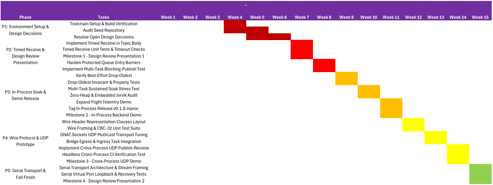
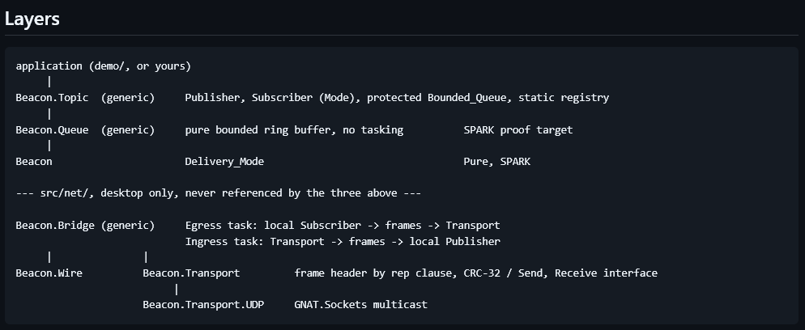

# STG-455 Weekly Status Update: Beacon
## Week 10 Status Report: Jorvik Compliance, Phase 2 Closure & Property Tests

**Course:** STG-455: Capstone Project I — Grand Canyon University  
**Project:** Beacon: Typed Publish-Subscribe Messaging Library in Ada  
**Reporting Period:** Week 10 (Ending November 15, 2026)  
**Overall Project Progress:** **19% Complete**  
**Engineering Team:**  
* Hovan Hodges (Core Systems Engineer)  
* Ryan Tomasko (Security & Validation Engineer)  
* Praise Jibunor (Network Systems Engineer)  
**Mentor:** Steven Faulkner (GCU Mentor) | **Industry Partner:** Olivier Henley (AdaCore GAP)  
**Repository:** [`GCU-beacon`](../..)  

---

## 1. Project Description

Beacon is a typed publish-subscribe messaging library: topics are Ada generic instantiations, so a subscriber to a `Telemetry_Topic` receives `Telemetry_Reading` values directly, never raw bytes to be cast and hoped about. It provides an in-process bounded-queue backend for single-application use and a network backend for cross-process communication on desktop.

---

## 2. Project Status Summary

**Percent Complete: 19%**  
During Week 10, the team worked in Phase 3 on the verification and compliance tasks that precede Milestone 2. After the Week 9 report, GNATprove was run against `Beacon.Queue` through a new proof harness ([`prove/prove.gpr`](../../prove/prove.gpr)) that instantiates the generic with a `Depth` the prover cannot see, so the result holds for every queue depth: all 71 checks proved (SPARK Silver plus the ring invariant), and CI now runs the proof. This replaced an earlier flow-analysis run that covered nothing because GNATprove skips generic units, and it removed a latent integer overflow in the ring index arithmetic. The team completed **Task 3.2 (Drop-Oldest Invariant & Property Tests)** on 11/7: a randomized suite ([`tests/src/queue_property_tests.adb`](../../tests/src/queue_property_tests.adb)) checks FIFO order, drop-oldest behavior, the ring invariant, and drop accounting against a reference model over 12 million operations across 12 queue depths, and it caught all four deliberately seeded ring bugs ([`docs/TASK_3_2_VERIFICATION_REPORT.md`](../TASK_3_2_VERIFICATION_REPORT.md)). A repository code review on 11/6 produced a follow-up plan ([`docs/UNSCHEDULED_CHANGES_REPORT.md`](../UNSCHEDULED_CHANGES_REPORT.md)) that added **Task 3.7 (Subscriber Lifecycle & Registry Lockdown)** and **Task 4.2b (In-Memory Loopback Transport & Bridge Tests)**, re-baselined Task 3.4 from 16 to 24 hours, and formally deferred the configurable `Try_Publish` policy (FR-08) to Spring 2027. The team completed **Task 3.4 (Zero-Heap & Embedded Jorvik Audit)** on 11/12. A trial compile of `Beacon.Topic` under the Jorvik profile had failed, so the task included code changes in addition to the audit: the entry barriers of `Bounded_Queue` now read `Full` and `Empty` Boolean components instead of calling functions, and the timed `Receive` moved to a full-tasking child package, `Beacon.Topic.Timed`. A new CI check ([`jorvik/jorvik.gpr`](../../jorvik/jorvik.gpr)) builds and runs the core under `pragma Profile (Jorvik)` with `No_Allocators`, `No_Implicit_Heap_Allocations`, and `No_Secondary_Stack`. The check runs on the native runtime; `gnatmem` is not in the team's toolchain, and nothing was run on an embedded runtime ([`docs/TASK_3_4_VERIFICATION_REPORT.md`](../TASK_3_4_VERIFICATION_REPORT.md)). **Task 3.3 (Multi-Task Sustained Soak Stress Test)** is in progress, and **Task 3.5 (Expand Flight Telemetry Demo)** started early this week and is forecast for 11/15. **Task 2.4 (Implement Multi-Task Blocking-Publish Test)** was completed on 11/12, which closes Phase 2. The test covers a publisher task that blocks on a full `Reliable` subscriber queue and resumes when the consumer drains it. The team also compiled the October expense report and met to discuss the implementation of Claude Pro accounts. Milestone 2 (`v0.1.0-inproc`) remains forecast for November 22, 2026.

---

## 3. Timeline Snapshot

The timeline snapshot below illustrates the engineering schedule for Project Beacon, translating AdaCore's overarching 32-week lifecycle roadmap into the team's 15-week Fall 2026 execution matrix across five sequential phases.

  
*Figure 1. GANTT Chart of Tasks for Fall 2026 Semester.*

Figure 1 exhibits the chronological progression of tasks, dependencies, and critical milestone gates structured across five distinct engineering phases:
* **Phase 1: Environment Setup & Design Decisions (Weeks 1–6, Sep 07 – Oct 18):** Focuses on onboarding, GNAT 2022 toolchain verification with Alire, auditing the Ada seed repository, and resolving open architectural decisions (e.g., timed receive semantics, static subscriber registry lockdown) in consultation with AdaCore and GCU mentors.
* **Phase 2: Timed Receive, Concurrency Hardening & Design Review 1 (Weeks 7–8, Oct 19 – Nov 01):** Focuses on core subscriber synchronization. Major deliverables include delivering Milestone 1 (Design Review Presentation 1), implementing timed `Receive` (which blocks until a message arrives or an `Ada.Real_Time.Time_Span` timeout expires), and hardening protected entry barriers under the Ceiling Priority Protocol (CPP).
* **Phase 3: In-Process Soak & Demo Release (Weeks 9–11, Nov 02 – Nov 22):** The current operating phase. It targets in-process core validation: formally proving ring buffer pointer arithmetic (Task 3.1), property-based invariant testing (Task 3.2), multi-task sustained soak stress testing at 1 kHz (Task 3.3), zero-heap Jorvik profile auditing (Task 3.4), and subscriber lifecycle and registry lockdown (Task 3.7, added after the 11/6 code review). This phase concludes at Week 11 with **Milestone 2: In-Process Backend Demo** and the tagging of the `v0.1.0-inproc` release.
* **Phase 4: Wire Protocol & UDP Prototype (Weeks 12–14, Nov 23 – Dec 13):** Transitions Beacon to distributed communication. Tasks encompass defining the 14-byte wire frame header using Ada representation clauses, implementing IEEE 802.3 CRC-32 integrity validation, adding an in-memory loopback transport for bridge tests (Task 4.2b), integrating background Ingress/Egress bridge tasks, and delivering **Milestone 3: Cross-Process UDP Demo**.
* **Phase 5: Serial Transport & Capstone Closure (Week 15, Dec 14 – Dec 20):** Encompasses embedded serial stream framing (COBS) over virtual ports and culminates in the delivery of **Milestone 4: Design Review Presentation 2**.

The team is currently operating in **Week 10, the second week of Phase 3**. Tasks 3.1, 3.2, and 3.4 are complete, and Tasks 3.3 and 3.5 are in progress. Task 2.4, carried over from Phase 2, was completed on 11/12, so Phase 2 is closed. Figure 1 predates the 11/6 schedule update and does not yet show Task 3.7 or Task 4.2b. Milestone 2 remains forecast for November 22, 2026.

---

## 4. Current Concept

  
*Figure 2. Current Design/Architecture Concept.*

Project Beacon is a typed publish-subscribe messaging library implemented in Ada 2022, engineered for safety-critical, hard real-time, and embedded aerospace applications. Figure 2 illustrates the layered system architecture, governed by the following core technical principles:

1. **Strict Downward Layering & Dependency Inversion:** Dependencies flow exclusively downward. The core messaging packages contain zero references to network sockets, heap allocators, or byte-level serialization. Network and bridge components act merely as external clients to the topic layer, ensuring that in-process embedded applications remain completely decoupled from network overhead.
2. **Decoupling Data Structures from Concurrency (SPARK Verification Boundary):**  
   * **`Beacon.Queue` (Generic Ring Buffer):** A pure, deterministic FIFO ring buffer implemented without tasking, entry barriers, or dynamic memory allocations. Because it operates solely on index arithmetic over a fixed array, it serves as the formal SPARK verification target for circular invariants.
   * **`Beacon.Topic` (Protected Concurrency Wrapper):** Wraps `Beacon.Queue` within an Ada `protected type Bounded_Queue`. It enforces task synchronization, ceiling priority locking (`Ceiling_Locking`), and barrier evaluation (`Reliable` vs. `Best_Effort`) while maintaining thread safety without muddying the mathematical proof of the underlying queue.
3. **Strongly Typed Generics vs. Untyped Casting:** Unlike traditional C/POSIX message brokers that exchange untyped `void*` buffers, Beacon instantiates topics as Ada generic packages parameterized by a concrete `Message_Type` (e.g., `Telemetry_Reading`). Publishers and subscribers exchange strongly typed Ada records directly, eliminating runtime type casting and serialization overhead in single-process deployments.
4. **Dual Quality of Service (QoS) Delivery Modes:** Each subscriber declares a delivery mode at instantiation:
   * **`Reliable` Mode:** Guarantees zero dropped messages. If a subscriber's queue fills to `Queue_Depth`, publishing tasks block at the entry barrier until room is freed, or `Try_Publish` reports `Delivered = False`.
   * **`Best_Effort` Mode:** Prioritizes telemetry freshness over completeness. If the queue is saturated, incoming messages overwrite the oldest unread element, and an internal saturation-bounded counter tracks drops without blocking publishers.
5. **Decoupled Desktop Network Transport (`Beacon.Bridge` & `Beacon.Wire`):** For multi-process communication on desktop platforms, `Beacon.Bridge` spawns independent Ingress and Egress tasks. Egress drains messages from a local subscriber, packages them into wire frames (a fixed 14-byte header governed by an Ada record representation clause, followed by the payload, with a CRC-32 checksum over both), and transmits them via UDP multicast (`GNAT.Sockets`). Ingress validates wire frames and injects them into local topics via `Try_Publish`, isolating in-process publishers from remote network latency.

---

## 5. Accomplishments and Learning

* **Hovan Hodges:**
  * Zero-Heap & Embedded Jorvik Audit (Accomplished)
* **Praise Jibunor:**
  * Expand Flight Telemetry Demo (In Progress)
* **Ryan Tomasko:**
  * Drop-Oldest Invariant & Property Tests (Accomplished)
  * Multi-Task Sustained Soak Stress Test (In Progress)
* **Team:**
  * Compile October Expense Report (Accomplished)
  * Meet to discuss implementation of Claude Pro accounts (Accomplished)

---

## 6. Work Planned for Next Week

* **Hovan Hodges:**
  * Subscriber Lifecycle & Registry Lockdown (Task 3.7)
* **Praise Jibunor:**
  * Tag In-Process Release v0.1.0-inproc (Task 3.6)
* **Ryan Tomasko:**
  * Validate Test Suites for the v0.1.0-inproc Release
* **Team:**
  * Tag In-Process Release v0.1.0-inproc (Task 3.6)
  * Deliver Milestone 2: In-Process Backend Demo
  * Obtain Updated Stakeholder Feedback

---

## 7. Risks

### Risk Management Matrix

| Risk ID | Category | Risk Description | Initial Logged | Current Status | Impact / Probability | Mitigation Strategy & Ownership |
| :---: | :---: | :--- | :---: | :---: | :---: | :--- |
| **R-01** | Technical | Ada 2022 & SPARK Proof Learning Curve delaying verification tasks. | Week 4 (1%) | **Monitored** | Medium / Low | Reference Ada 2022 Reference Manual and GAP guidelines; incremental proof strategy separating pure queue logic from tasking. *(Lead: Hovan Hodges)* |
| **R-02** | Technical | Risk of inadvertent dynamic memory allocations or secondary stack usage violating the Ada Jorvik profile. | Week 6 (5%) | **Mitigated** | Medium / Low | Task 3.4 (completed 11/12) made the entry barriers read Boolean components and moved the timed `Receive` to `Beacon.Topic.Timed`. The core now builds and runs under `pragma Profile (Jorvik)` with no-heap and no-secondary-stack restrictions, and CI runs this check. Not yet run on an embedded runtime. *(Lead: Hovan Hodges)* |
| **R-03** | Organizational | Loss of a team member in Week 7 potentially impacting validation cadence and documentation. | Week 7 (7%) | **Resolved** | Medium / Low | Work breakdown structure successfully consolidated; Ryan Tomasko assumed Security & Validation responsibilities, and Praise Jibunor absorbed bridge verification. Velocity is stabilized. *(Full Team)* |
| **R-04** | Technical | Risk of deadlock, starvation, or priority inversions under high-concurrency multi-task publishing. | Week 8 (10%) | **Mitigated** | High / Low | Enforced Ceiling Priority Protocol (`Ceiling_Locking`, `Priority_Queuing`) in `gnat.adc` and bound `Ceiling_Priority` aspect to protected queues. Blocking behavior under contention is covered by the multi-task test from Task 2.4 (completed 11/12). *(Lead: Praise Jibunor)* |
| **R-05** | Technical | Sustained 1 kHz multi-task load exposing thread scheduling anomalies, CPU starvation, or violations of the `Dropped(Reliable) = 0` invariant. | Week 9 (13%) | **Active** | High / Medium | Phased load ramp-up; property-based test harness validates edge cases before 1-hour sustained soak runs; test harness tracks atomic metrics and high-resolution timing. *(Lead: Ryan Tomasko)* |
| **R-06** | Schedule | Code review follow-up work (Task 3.7 added, Task 3.4 re-baselined from 16 to 24 hours) compressing the Week 11 schedule ahead of Milestone 2. | Week 10 (16%) | **Active** | Medium / Medium | Follow-up decisions recorded on 11/6 and applied to the WBS and Gantt schedule; configurable `Try_Publish` (FR-08) deferred to Spring 2027; Tasks 2.4 and 3.4 completed 11/12, so Task 3.7 can start on schedule. *(Full Team)* |

### Updates for Active Risks
* **Risk R-02 (Mitigated):** A trial compile of `Beacon.Topic` on 11/6 under the Jorvik profile failed on `Pure_Barriers` (both entry barriers called `Ring.Is_Full` / `Ring.Is_Empty`) and on `No_Select_Statements` (the timed `Receive` uses `select ... or delay`). Task 3.4 fixed both on 11/12: the barriers read `Full` and `Empty` Boolean components refreshed by every queue operation, and the timed `Receive` moved to a full-tasking child package, `Beacon.Topic.Timed`. CI now builds and runs the core under the Jorvik profile with heap and secondary-stack restrictions. Residual risk: the check runs on the native runtime, `gnatmem` was not available, and timing and stack sizes on an embedded target are untested.
* **Risk R-04 (Mitigated):** The Ceiling Priority Protocol configuration added in Week 9 bounds priority inversion, and drop counters saturate instead of overflowing. The earlier topic tests ran in a single task. The multi-task blocking-publish test from Task 2.4, completed on 11/12, now covers blocking behavior under real contention.
* **Risk R-05 (Active Focus for Phase 3):** The soak stress test (Task 3.3) is in progress this week and will run against the entry barriers changed in Task 3.4. The primary risk remains host operating system scheduling latency affecting high-frequency message exchange. Mitigation includes isolating test runs to dedicated CPU cores and verifying that `Dropped = 0` holds strictly for all `Reliable` subscribers regardless of queue occupancy. The property-based suite completed in Task 3.2 covers the single-task ring behavior ahead of the sustained runs.
* **Risk R-06 (Active, New):** The 11/6 code review added Task 3.7 to Week 11 and enlarged Task 3.4, and Task 2.4 carried over from Week 8. Both Task 2.4 and Task 3.4 closed on 11/12, so no Phase 2 work remains and Task 3.7 can start on schedule. Task 3.5 started early in Week 10 and is forecast for 11/15, which leaves Tasks 3.6 and 3.7 plus the Milestone 2 demo in Week 11. The team also deferred the configurable `Try_Publish` policy (FR-08) to Spring 2027 to contain the schedule.

---

## 8. Deliverables and Milestones

### Milestones
| Milestone | Planned | Forecasted | Actual | Status |
| :--- | :---: | :---: | :---: | :--- |
| Initial Research & Design | 10/04 | 10/04 | 10/04 | **Completed** |
| First meeting with AdaCore contact | 10/14 | 10/14 | 10/14 | **Completed** |
| Design Review Presentation Meeting | 10/22 | 10/22 | 10/22 | **Completed** |
| In-Process Backend Demo | 11/22 | 11/22 | — | **In Progress** |

### Deliverables
| Deliverable | Planned | Forecasted | Actual | Status |
| :--- | :---: | :---: | :---: | :--- |
| Team Members Specific Roles & Responsibilities | 10/08 | 10/08 | 10/08 | **Completed** |
| Research Industry Standards | 10/11 | 10/11 | 10/11 | **Completed** |
| Gather Stakeholder Feedback | 10/15 | 10/15 | 10/15 | **Completed** |
| Create Bill of Materials (BOM) for Software and Cloud-Based Projects | 10/18 | 10/18 | 10/18 | **Completed** |
| Finalize Product Functional Requirements | 10/18 | 10/18 | 10/18 | **Completed** |
| Finalize Project Timeline and Work Breakdown Structure | 10/18 | 10/18 | 10/18 | **Completed** |
| Implement Timed Receive in Topic Body | 10/25 | 10/25 | 10/28 | **Completed** |
| Implement Timed Receive Unit Tests & Timeout Checks | 10/25 | 11/01 | 10/29 | **Completed** |
| Implement Hardened Protected Queue Entry Barriers | 11/01 | 11/01 | 11/02 | **Completed** |
| Complete Project Portfolio | 11/01 | 11/01 | 11/01 | **Completed** |
| Implement Multi-Task Blocking-Publish Test | 11/01 | 11/08 | 11/12 | **Completed** |
| Verify Best-Effort Drop-Oldest | 11/08 | 11/08 | 11/04 | **Completed** |
| Drop-Oldest Invariant & Property Tests | 11/08 | 11/08 | 11/07 | **Completed** |
| Compile October Expense Report | 11/08 | 11/08 | 11/07 | **Completed** |
| Multi-Task Sustained Soak Stress Test | 11/15 | 11/15 | — | **In Progress** |
| Zero-Heap & Embedded Jorvik Audit | 11/15 | 11/15 | 11/12 | **Completed** |
| Expand Flight Telemetry Demo | 11/22 | 11/15 | — | **In Progress** |
| Subscriber Lifecycle & Registry Lockdown | 11/22 | 11/22 | — | **Not Started** |
| Tag In-Process Release v0.1.0-inproc | 11/22 | 11/22 | — | **Not Started** |
| Updated Stakeholder Feedback | 11/22 | 11/22 | — | **Not Started** |

---

## 9. Attachments

* N/A.

---

## 10. Approvals

| Team Role | Print Name | Signature | Date |
| :--- | :--- | :---: | :---: |
| **Mentor** | Steven Faulkner | | |
| **Core Engineer** | Hovan Hodges | | |
| **Security Engineer** | Ryan Tomasko | | |
| **Network Engineer** | Praise Jibunor | | |
