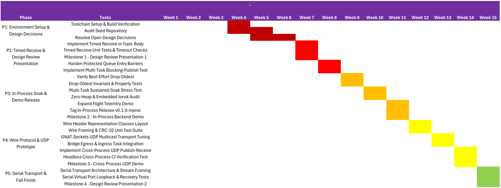
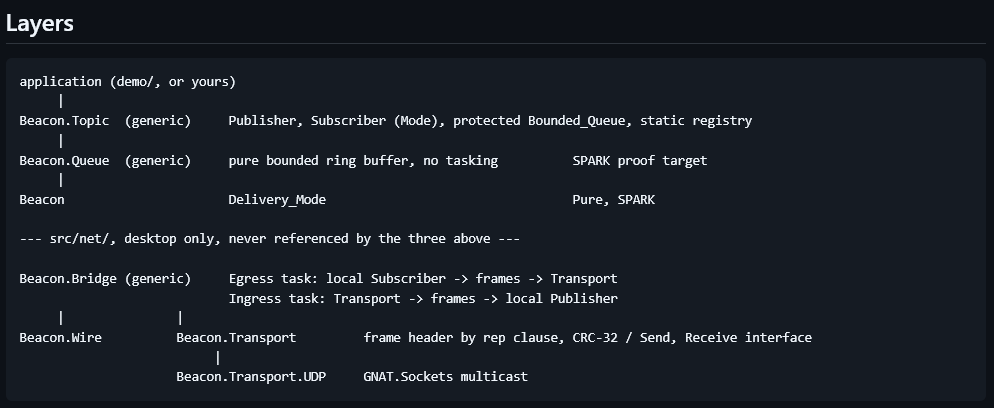

# STG-455 Weekly Status Update: Beacon
## Week 11 Status Report: Registry Lockdown, Flight Telemetry Demo & v0.1.0-inproc Release

**Course:** STG-455: Capstone Project I — Grand Canyon University  
**Project:** Beacon: Typed Publish-Subscribe Messaging Library in Ada  
**Reporting Period:** Week 11 (Ending November 22, 2026; status as of November 18, 2026)  
**Overall Project Progress:** **28% Complete**  
**Engineering Team:**  
* Hovan Hodges (Core Systems Engineer)  
* Ryan Tomasko (Security & Validation Engineer)  
* Praise Jibunor (Network Systems Engineer)  
**Mentor:** Steven Faulkner (GCU Mentor) | **Industry Partner:** Olivier Henley (AdaCore GAP)  
**Repository:** [`GCU-beacon`](../..)  

---

## 1. Project Description

Beacon is a typed publish-subscribe messaging library: topics are Ada generic instantiations, so a subscriber to a `Telemetry_Topic` receives `Telemetry_Reading` values directly, never raw bytes to be cast and hoped about. It provides an in-process bounded-queue backend for single-application use and a network backend for cross-process communication on desktop.

---

## 2. Project Status Summary

**Percent Complete: 28%**  
During Week 11, the team finished every Phase 3 engineering task and released the in-process core. **Task 3.3 (Multi-Task Sustained Soak Stress Test)** was completed on 11/15, after the Week 10 report: [`tests/src/topic_soak_tests.adb`](../../tests/src/topic_soak_tests.adb) runs a 1 kHz soak and then a `Publish` flood and a `Try_Publish` flood at the same time, and it checks that `Dropped (Reliable) = 0` and that every Reliable message arrives once and in order. Doing this, I had the program run the test for over 10 minutes to see how the system handles a long stress test. A 600 s run plus two 5,000,000-message floods passed with no memory growth, and the suite runs in CI ([`docs/TASK_3_3_VERIFICATION_REPORT.md`](../TASK_3_3_VERIFICATION_REPORT.md)). The team completed **Task 3.7 (Subscriber Lifecycle & Registry Lockdown)** on 11/16. The first `Publish` or `Try_Publish` now locks the subscriber registry for the rest of the program, `Create_Subscriber` and the new `Delete_Subscriber` require that the registry is not locked, and the preconditions of `Beacon.Topic` are checked in every build, so the lock cannot be compiled out. This closes Open Decisions #2 and #4 from the seed README and fixes the Task 4.4 bridge registration race. The team also completed **Task 3.5 (Expand Flight Telemetry Demo)** on 11/16: [`demo/src/inproc_demo.adb`](../../demo/src/inproc_demo.adb) now runs a small satellite with attitude (about 1 kHz), control loop (about 100 Hz), ground command (about 10 Hz) and power (about 5 Hz) topics, and ten checks make it exit non-zero on any failure. The Task 2.2 timeout checks, which the Task 3.4 move of timed `Receive` had left behind, were restored in [`tests/src/topic_timed_tests.adb`](../../tests/src/topic_timed_tests.adb). The test suites were validated for the release, and **Task 3.6 (Tag In-Process Release v0.1.0-inproc)** was completed on 11/18. The release commit sets the three crates to `0.1.0-inproc` and adds [`CHANGELOG.md`](../../CHANGELOG.md). The tag was created only after the full CI workflow passed on that commit (both library builds, all six test suites, the Jorvik check, the in-process and UDP demos, and the GNATprove proof), and the release is published as a [GitHub pre-release](https://github.com/H000V/GCU-beacon/releases/tag/v0.1.0-inproc). The release covers the in-process core in `src/`; `src/net/` ships as an experimental preview. `main` has moved on to `0.2.0-dev`. **Milestone 2 (In-Process Backend Demo)** is forecast for 11/20, two days ahead of plan, and the team will collect updated stakeholder feedback at the demo. For Phase 4, Task 4.2b moves from Ryan Tomasko to Hovan Hodges, so each engineer holds one task in Week 12.

---

## 3. Timeline Snapshot

The timeline snapshot below illustrates the engineering schedule for Project Beacon, translating AdaCore's overarching 32-week lifecycle roadmap into the team's 15-week Fall 2026 execution matrix across five sequential phases.

  
*Figure 1. GANTT Chart of Tasks for Fall 2026 Semester.*

Figure 1 exhibits the chronological progression of tasks, dependencies, and critical milestone gates structured across five distinct engineering phases:
* **Phase 1: Environment Setup & Design Decisions (Weeks 1–6, Sep 07 – Oct 18):** Focuses on onboarding, GNAT 2022 toolchain verification with Alire, auditing the Ada seed repository, and resolving open architectural decisions (e.g., timed receive semantics, static subscriber registry lockdown) in consultation with AdaCore and GCU mentors.
* **Phase 2: Timed Receive, Concurrency Hardening & Design Review 1 (Weeks 7–8, Oct 19 – Nov 01):** Focuses on core subscriber synchronization. Major deliverables include delivering Milestone 1 (Design Review Presentation 1), implementing timed `Receive` (which blocks until a message arrives or an `Ada.Real_Time.Time_Span` timeout expires), and hardening protected entry barriers under the Ceiling Priority Protocol (CPP).
* **Phase 3: In-Process Soak & Demo Release (Weeks 9–11, Nov 02 – Nov 22):** The current operating phase. It targets in-process core validation: formally proving ring buffer pointer arithmetic (Task 3.1), property-based invariant testing (Task 3.2), multi-task sustained soak stress testing at 1 kHz (Task 3.3), zero-heap Jorvik profile auditing (Task 3.4), the flight telemetry demo (Task 3.5), subscriber lifecycle and registry lockdown (Task 3.7, added after the 11/6 code review), and the `v0.1.0-inproc` release (Task 3.6). This phase concludes with **Milestone 2: In-Process Backend Demo**.
* **Phase 4: Wire Protocol & UDP Prototype (Weeks 12–14, Nov 23 – Dec 13):** Transitions Beacon to distributed communication. Tasks encompass defining the 14-byte wire frame header using Ada representation clauses, implementing IEEE 802.3 CRC-32 integrity validation, adding an in-memory loopback transport for bridge tests (Task 4.2b), integrating background Ingress/Egress bridge tasks, and delivering **Milestone 3: Cross-Process UDP Demo**.
* **Phase 5: Serial Transport & Capstone Closure (Week 15, Dec 14 – Dec 20):** Encompasses embedded serial stream framing (COBS) over virtual ports and culminates in the delivery of **Milestone 4: Design Review Presentation 2**.

The team is currently operating in **Week 11, the final week of Phase 3**. All seven Phase 3 tasks (3.1 through 3.7) are complete, and only the Milestone 2 demo remains, forecast for 11/20. Phase 4 starts on 11/23. Figure 1 predates the 11/6 schedule update and does not yet show Task 3.7 or Task 4.2b.

---

## 4. Current Concept

  
*Figure 2. Current Design/Architecture Concept.*

Project Beacon is a typed publish-subscribe messaging library implemented in Ada 2022, engineered for safety-critical, hard real-time, and embedded aerospace applications. Figure 2 illustrates the layered system architecture, governed by the following core technical principles:

1. **Strict Downward Layering & Dependency Inversion:** Dependencies flow exclusively downward. The core messaging packages contain zero references to network sockets, heap allocators, or byte-level serialization. Network and bridge components act merely as external clients to the topic layer, ensuring that in-process embedded applications remain completely decoupled from network overhead.
2. **Decoupling Data Structures from Concurrency (SPARK Verification Boundary):**  
   * **`Beacon.Queue` (Generic Ring Buffer):** A pure, deterministic FIFO ring buffer implemented without tasking, entry barriers, or dynamic memory allocations. Because it operates solely on index arithmetic over a fixed array, it serves as the formal SPARK verification target for circular invariants.
   * **`Beacon.Topic` (Protected Concurrency Wrapper):** Wraps `Beacon.Queue` within an Ada `protected type Bounded_Queue`. It enforces task synchronization, ceiling priority locking (`Ceiling_Locking`), and barrier evaluation (`Reliable` vs. `Best_Effort`) while maintaining thread safety without muddying the mathematical proof of the underlying queue.
3. **Strongly Typed Generics vs. Untyped Casting:** Unlike traditional C/POSIX message brokers that exchange untyped `void*` buffers, Beacon instantiates topics as Ada generic packages parameterized by a concrete `Message_Type` (e.g., `Telemetry_Reading`). Publishers and subscribers exchange strongly typed Ada records directly, eliminating runtime type casting and serialization overhead in single-process deployments.
4. **Dual Quality of Service (QoS) Delivery Modes:** Each subscriber declares a delivery mode at instantiation:
   * **`Reliable` Mode:** Guarantees zero dropped messages. If a subscriber's queue fills to `Queue_Depth`, publishing tasks block at the entry barrier until room is freed, or `Try_Publish` reports `Delivered = False`.
   * **`Best_Effort` Mode:** Prioritizes telemetry freshness over completeness. If the queue is saturated, incoming messages overwrite the oldest unread element, and an internal saturation-bounded counter tracks drops without blocking publishers.
5. **Static Subscriber Registry with Lockdown:** Subscribers register at startup, before any message flows. The first `Publish` or `Try_Publish` locks the registry for the rest of the program (`Is_Locked`), after which `Create_Subscriber` and `Delete_Subscriber` fail their preconditions. The registry is therefore static while messages flow and never holds a dangling access value. These preconditions are checked in every build.
6. **Decoupled Desktop Network Transport (`Beacon.Bridge` & `Beacon.Wire`):** For multi-process communication on desktop platforms, `Beacon.Bridge` spawns independent Ingress and Egress tasks. Egress drains messages from a local subscriber, packages them into wire frames (a fixed 14-byte header governed by an Ada record representation clause, followed by the payload, with a CRC-32 checksum over both), and transmits them via UDP multicast (`GNAT.Sockets`). Ingress validates wire frames and injects them into local topics via `Try_Publish`, isolating in-process publishers from remote network latency.

---

## 5. Accomplishments and Learning

* **Hovan Hodges:**
  * Subscriber Lifecycle & Registry Lockdown (Accomplished)
    * Added a registry lock set by the first `Publish`, an `Is_Locked` query and `Delete_Subscriber`, made the `Beacon.Topic` preconditions checked in every build, and covered it with 16 new checks in `topic_tests` and `jorvik_check`.
  * Tag In-Process Release v0.1.0-inproc (Accomplished)
    * Wrote `CHANGELOG.md`, set the crates to `0.1.0-inproc`, tagged the release after the full CI workflow passed, published the GitHub pre-release, and moved `main` to `0.2.0-dev`.
* **Praise Jibunor:**
  * Expand Flight Telemetry Demo (Accomplished)
    * Rebuilt `inproc_demo` as a satellite with attitude, control loop, power and ground command topics. Ten checks confirm Reliable topics lose nothing and Best_Effort topics keep the newest value, and the demo exits non-zero on any failure.
  * Restore Task 2.2 Timed Receive Timeout Checks (Accomplished)
    * Moved the four Task 2.2 timeout checks that were left behind when Task 3.4 moved timed `Receive` into [`tests/src/topic_timed_tests.adb`](../../tests/src/topic_timed_tests.adb): blocking for the full timeout, a negative timeout returning at once, a waiting message returned without waiting, and a repeated timeout leaving the queue empty.
* **Ryan Tomasko:**
  * Multi-Task Sustained Soak Stress Test (Accomplished)
  * Validate Test Suites for the v0.1.0-inproc Release (Accomplished)
* **Team:**
  * Deliver Milestone 2: In-Process Backend Demo (In Progress, forecast 11/20)
  * Obtain Updated Stakeholder Feedback (In Progress, to be collected at the Milestone 2 demo)

---

## 6. Work Planned for Next Week

* **Hovan Hodges:**
  * In-Memory Loopback Transport & Bridge Tests (Task 4.2b, reassigned from Ryan Tomasko)
    * Build an in-memory transport behind the `Beacon.Transport` interface and a single-process test suite that checks bridge delivery and counters without UDP multicast.
* **Praise Jibunor:**
  * Wire Header Representation Clauses Layout (Task 4.1)
    * Set `Alignment => 1` on `Wire.Header` so the header can be read at any byte offset in a buffer, confirm `Header'Size` is still 112, and finish early in the week so Tasks 4.2 and 4.2b can start on time.
* **Ryan Tomasko:**
  * Wire Framing & CRC-32 Unit Test Suite (Task 4.2)
  * Prepare for stakeholder feedback meeting
* **Team:**
  * Record the Milestone 2 Outcome and Updated Stakeholder Feedback

---

## 7. Risks

### Risk Management Matrix

| Risk ID | Category | Risk Description | Initial Logged | Current Status | Impact / Probability | Mitigation Strategy & Ownership |
| :---: | :---: | :--- | :---: | :---: | :---: | :--- |
| **R-01** | Technical | Ada 2022 & SPARK Proof Learning Curve delaying verification tasks. | Week 4 (1%) | **Monitored** | Medium / Low | Reference Ada 2022 Reference Manual and GAP guidelines; incremental proof strategy separating pure queue logic from tasking. *(Lead: Hovan Hodges)* |
| **R-02** | Technical | Risk of inadvertent dynamic memory allocations or secondary stack usage violating the Ada Jorvik profile. | Week 6 (5%) | **Mitigated** | Medium / Low | Task 3.4 (completed 11/12) made the entry barriers read Boolean components and moved the timed `Receive` to `Beacon.Topic.Timed`. The core builds and runs under `pragma Profile (Jorvik)` with no-heap and no-secondary-stack restrictions, and CI runs this check. Not yet run on an embedded runtime. *(Lead: Hovan Hodges)* |
| **R-03** | Organizational | Loss of a team member in Week 7 potentially impacting validation cadence and documentation. | Week 7 (7%) | **Resolved** | Medium / Low | Work breakdown structure successfully consolidated; Ryan Tomasko assumed Security & Validation responsibilities, and Praise Jibunor absorbed bridge verification. Velocity is stabilized. *(Full Team)* |
| **R-04** | Technical | Risk of deadlock, starvation, or priority inversions under high-concurrency multi-task publishing. | Week 8 (10%) | **Mitigated** | High / Low | Enforced Ceiling Priority Protocol (`Ceiling_Locking`, `Priority_Queuing`) in `gnat.adc` and bound `Ceiling_Priority` aspect to protected queues. Blocking behavior under contention is covered by the Task 2.4 multi-task test and the Task 3.3 soak, whose watchdog fails the run on deadlock. *(Lead: Praise Jibunor)* |
| **R-05** | Technical | Sustained 1 kHz multi-task load exposing thread scheduling anomalies, CPU starvation, or violations of the `Dropped(Reliable) = 0` invariant. | Week 9 (13%) | **Mitigated** | High / Low | Task 3.3 (completed 11/15) holds `Dropped(Reliable) = 0` with in-order, exactly-once Reliable delivery under a 1 kHz soak and concurrent floods, in CI on every push. Latency is measured, not gated; on Windows the 16 ms timer tick dominates desktop timing, so timing figures come from the Linux CI log. *(Lead: Ryan Tomasko)* |
| **R-06** | Schedule | Code review follow-up work (Task 3.7 added, Task 3.4 re-baselined from 16 to 24 hours) compressing the Week 11 schedule ahead of Milestone 2. | Week 10 (16%) | **Resolved** | Medium / Low | Tasks 3.5 and 3.7 were completed on 11/16 and Task 3.6 on 11/18, ahead of the 11/22 plan; Milestone 2 is forecast for 11/20. *(Full Team)* |
| **R-07** | Schedule | Week 12 (Nov 23 – Nov 29) falls over Thanksgiving and holds three Phase 4 tasks (4.1, 4.2 and 4.2b), two of which list Task 4.1 as a predecessor. | Week 11 (28%) | **Active** | Medium / Medium | Task 4.2b moved from Ryan Tomasko to Hovan Hodges, so each engineer holds one Week 12 task instead of Ryan holding two. Task 4.1 starts from a fix already defined in the 11/6 code review (`Alignment => 1` on `Header`, then confirm `Header'Size` is still 112). *(Full Team)* |

### Updates for Active Risks
* **Risk R-05 (Mitigated):** The soak stress test (Task 3.3) passed on 11/15 against the entry barriers changed in Task 3.4, and it caught all four seeded `Beacon.Topic` bugs, so it now guards later edits in CI. The residual risk is timing on desktop Windows: the 16 ms timer tick makes a 1 ms `delay` last about 15 ms. The release check on 11/18 saw the same effect in the UDP demo, which needed a longer subscriber window on Windows to receive all 200 readings, with no sequence gaps. The team uses the Linux CI log for timing figures.
* **Risk R-06 (Resolved):** Every Phase 3 task closed by 11/18, four days before the end of Week 11, and the `v0.1.0-inproc` release was tagged after a full green CI run. The configurable `Try_Publish` policy (FR-08) stays deferred to Spring 2027 and is listed as a known limitation in [`CHANGELOG.md`](../../CHANGELOG.md).
* **Risk R-07 (Active, New):** Phase 4 opens in Thanksgiving week. Tasks 4.2 and 4.2b both depend on Task 4.1, and all three are scheduled in Week 12. Moving Task 4.2b to Hovan Hodges spreads the load evenly. The team will watch whether Task 4.1 lands early enough in the week for its successors to finish by 11/29.

---

## 8. Deliverables and Milestones

### Milestones
| Milestone | Planned | Forecasted | Actual | Status |
| :--- | :---: | :---: | :---: | :--- |
| Initial Research & Design | 10/04 | 10/04 | 10/04 | **Completed** |
| First meeting with AdaCore contact | 10/14 | 10/14 | 10/14 | **Completed** |
| Design Review Presentation Meeting | 10/22 | 10/22 | 10/22 | **Completed** |
| In-Process Backend Demo | 11/22 | 11/20 | — | **In Progress** |

### Deliverables
| Deliverable | Planned | Forecasted | Actual | Status |
| :--- | :---: | :---: | :---: | :--- |
| Team Members Specific Roles & Responsibilities | 10/08 | 10/08 | 10/08 | **Completed** |
| Research Industry Standards | 10/11 | 10/11 | 10/11 | **Completed** |
| Gather Stakeholder Feedback | 10/15 | 10/15 | 10/15 | **Completed** |
| Create Bill of Materials (BOM) for Software and Cloud-Based Projects | 10/18 | 10/18 | 10/18 | **Completed** |
| Finalize Product Functional Requirements | 10/18 | 10/18 | 10/18 | **Completed** |
| Finalize Project Timeline and Work Breakdown Structure | 10/18 | 10/18 | 10/18 | **Completed** |
| Implement Timed Receive in Topic Body | 10/25 | 10/25 | 10/28 | **Completed** |
| Implement Timed Receive Unit Tests & Timeout Checks | 10/25 | 11/01 | 10/29 | **Completed** |
| Implement Hardened Protected Queue Entry Barriers | 11/01 | 11/01 | 11/02 | **Completed** |
| Complete Project Portfolio | 11/01 | 11/01 | 11/01 | **Completed** |
| Implement Multi-Task Blocking-Publish Test | 11/01 | 11/08 | 11/12 | **Completed** |
| Verify Best-Effort Drop-Oldest | 11/08 | 11/08 | 11/04 | **Completed** |
| Drop-Oldest Invariant & Property Tests | 11/08 | 11/08 | 11/07 | **Completed** |
| Compile October Expense Report | 11/08 | 11/08 | 11/07 | **Completed** |
| Multi-Task Sustained Soak Stress Test | 11/15 | 11/15 | 11/15 | **Completed** |
| Zero-Heap & Embedded Jorvik Audit | 11/15 | 11/15 | 11/12 | **Completed** |
| Expand Flight Telemetry Demo | 11/22 | 11/15 | 11/16 | **Completed** |
| Subscriber Lifecycle & Registry Lockdown | 11/22 | 11/22 | 11/16 | **Completed** |
| Tag In-Process Release v0.1.0-inproc | 11/22 | 11/22 | 11/18 | **Completed** |
| Updated Stakeholder Feedback | 11/22 | 11/20 | — | **In Progress** |
| Wire Header Representation Clauses Layout | 11/29 | 11/29 | — | **Not Started** |
| Wire Framing & CRC-32 Unit Test Suite | 11/29 | 11/29 | — | **Not Started** |
| In-Memory Loopback Transport & Bridge Tests | 11/29 | 11/29 | — | **Not Started** |

---

## 9. Attachments

* `CHANGELOG.md`, release notes for `v0.1.0-inproc`: [https://github.com/H000V/GCU-beacon/blob/main/CHANGELOG.md](https://github.com/H000V/GCU-beacon/blob/main/CHANGELOG.md)
* GitHub pre-release: [`v0.1.0-inproc`](https://github.com/H000V/GCU-beacon/releases/tag/v0.1.0-inproc).

---

## 10. Approvals

| Team Role | Print Name | Signature | Date |
| :--- | :--- | :---: | :---: |
| **Mentor** | Steven Faulkner | | |
| **Core Engineer** | Hovan Hodges | | |
| **Security Engineer** | Ryan Tomasko | | |
| **Network Engineer** | Praise Jibunor | | |
